---
tags:
  - Kotlin
  - CheatSheet
  - Compose
  - MVVM
  - ViewModel
  - StateFlow
  - Arquitectura
  - DAM2
---

# Ejemplos Kotlin: MVVM con Compose

Estos apuntes continúan [[Compose Composición Kotlin]]. Allí la conversación de mensajes guardaba los datos en un `val messages` global y el estado en `remember`. Aquí se reparte el mismo programa en tres capas: **Model**, **ViewModel** y **View**.

> [!info] Apuntes relacionados
> - [[Compose Composición Kotlin]]: composables, `remember`, `mutableStateOf` y el ejercicio 9 («Dónde vive el estado»), que es el punto de partida de estos apuntes.
> - [[Jetpack Compose UI Kotlin]] (apartados «State hoisting» y «`remember` vs `ViewModel`»): la versión Android de las mismas ideas.
> - [[Coroutines Scope Kotlin]] y [[Coroutines Dispatcher Kotlin]]: `launch`, scopes y `Dispatchers`, que usa `viewModelScope`.
> - [[Juego Parejas MVVM Kotlin]]: caso práctico en Android (juego de parejas con `mutableStateOf` en el ViewModel).

### Cómo leer los esquemas

Cada apartado termina con el trozo del flujo que le corresponde, y al final del archivo está el esquema completo:

- **Nodos amarillos:** clases, métodos o datos explicados en ese apartado.
- **Nodos grises discontinuos:** contexto de otros apartados.
- **Flecha continua:** los datos pasan al siguiente paso o se llama al método.
- **Flecha discontinua:** relación, suscripción o consecuencia.

## Por qué hace falta MVVM

En el ejemplo completo de [[Compose Composición Kotlin#Ejemplo completo]] todo vive en el mismo archivo y nada separa *qué datos hay* de *cómo se dibujan*:

```kotlin
// Los datos son una variable global: cualquier composable puede leerlos,
// pero ninguno puede cambiarlos de forma ordenada.
val messages = listOf(Message("Josep Pla", "Antigament, el viatjar..."))

@Composable
fun App() {
    MaterialTheme {
        // La pantalla depende directamente de la global: no hay forma de cargarla,
        // marcarla como leída ni borrar un mensaje sin tocar la interfaz.
        Conversation(messages)
    }
}
```

Esto funciona mientras los datos no cambian. En cuanto quieres **cargarlos** (de un archivo, de una API), **modificarlos** (marcar como leído, borrar) o que **sobrevivan** a que la pantalla se recree, necesitas un sitio que:

1. Guarde el estado de la pantalla **fuera** de los composables.
2. Reciba los eventos del usuario y decida qué cambia.
3. No sepa nada de `Text`, `Column` ni `MaterialTheme`.

Ese sitio es el **ViewModel**.

Flujo de este apartado: sin capas, la pantalla depende directamente de los datos.

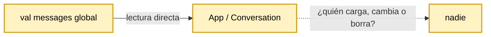

## Las tres capas

| Capa | Qué contiene | Qué **no** puede hacer | En el ejemplo |
|---|---|---|---|
| **Model** | Los datos y de dónde salen | Saber que existe una pantalla | `Message`, `MessageRepository` |
| **ViewModel** | El estado de la pantalla y la lógica de los eventos | Importar nada de `androidx.compose.ui` ni `material3` | `ConversationViewModel` |
| **View** | Los composables | Decidir reglas de negocio o guardar los datos | `ConversationScreen`, `MessageCard` |

La regla de dependencias va **en un solo sentido**: la View conoce al ViewModel, y el ViewModel conoce al Model. Nunca al revés.

> [!tip] Viniendo de automatización
> Es la misma separación que en una instalación con PLC y SCADA: el **Model** son los sensores y la base de datos de proceso, el **ViewModel** es el programa del PLC que decide, y la **View** es la pantalla del HMI. El HMI muestra variables y envía órdenes, pero la lógica no vive en la pantalla.

Flujo de este apartado: las dependencias bajan, nunca suben.

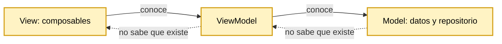

## Dependencias en `module.yaml`

Se parte del `module.yaml` de [[Compose Composición Kotlin#Entorno de trabajo]] y se añade la biblioteca de ViewModel multiplataforma de JetBrains (la de Google, `androidx.lifecycle`, solo sirve para Android):

```yaml
product: jvm/app

dependencies:
  - $compose.desktop.currentOs
  - $compose.material3
  # ViewModel + viewModel() para Compose fuera de Android.
  # Comprueba que la versión es compatible con la de Compose que resuelve tu toolchain.
  - org.jetbrains.androidx.lifecycle:lifecycle-viewmodel-compose:2.8.4

settings:
  compose: enabled
```

> [!warning] `Dispatchers.Main` en escritorio
> `viewModelScope` lanza las corrutinas en `Dispatchers.Main`. En escritorio ese hilo lo aporta `kotlinx-coroutines-swing`, que ya entra como dependencia de `$compose.desktop.currentOs`. Si ves `Module with the Main dispatcher is missing`, añádelo a mano. Repaso de dispatchers en [[Coroutines Dispatcher Kotlin]].

En **Android** el equivalente es:

```kotlin
dependencies {
    // ViewModel y la función viewModel() para Compose
    implementation("androidx.lifecycle:lifecycle-viewmodel-compose:$lifecycleVersion")
    // collectAsStateWithLifecycle(): deja de recoger el flujo cuando la app va a segundo plano
    implementation("androidx.lifecycle:lifecycle-runtime-compose:$lifecycleVersion")
}
```

Flujo de este apartado: la biblioteca aporta las tres piezas que usan los demás apartados.

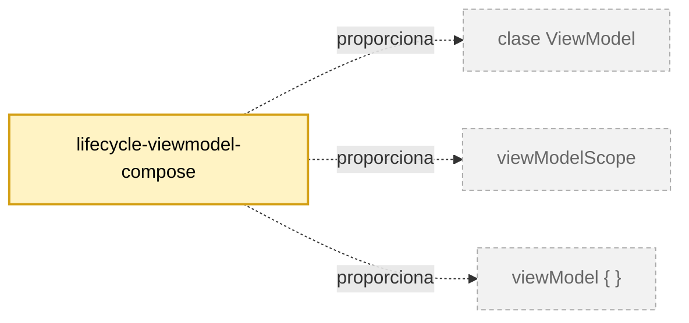

## Model: los datos y su origen

```kotlin
import kotlinx.coroutines.delay

// data class por el mismo motivo que en Compose Composición: equals gratis.
// Ahora además lleva un id, porque para "marcar como leído" hay que saber CUÁL.
// Comparar por author o body fallaría con dos mensajes iguales.
data class Message(
    val id: Int,
    val author: String,
    val body: String,
    // Valor por defecto: los mensajes nuevos llegan sin leer.
    val read: Boolean = false,
)

// El repositorio es la ÚNICA puerta a los datos. Hoy es una lista fija;
// mañana puede ser un archivo o una API y el ViewModel no se entera del cambio.
class MessageRepository {
    private val messages = listOf(
        Message(1, "Josep Pla", "Antigament, el viatjar era un privilegi de gran senyor."),
        Message(2, "Josep Pla", "Però, potser, les persones que viatgen són més rares avui."),
        Message(3, "Eva", "En el pot petit hi ha la bona confitura."),
    )

    // suspend porque una carga real tarda: así la firma ya está preparada
    // para una base de datos o HTTP sin cambiar a quien la llama.
    suspend fun loadMessages(): List<Message> {
        // Simula la espera de una carga real. delay suspende, no bloquea el hilo.
        delay(1000)
        return messages
    }
}
```

Lo importante es lo que **falta**: no hay ni un `import` de Compose. El Model se puede probar con un `main` de consola.

Flujo de este apartado: el repositorio entrega una lista de `Message`.

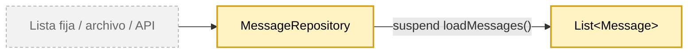

## El estado de la pantalla: `UiState`

Todo lo que la pantalla necesita para dibujarse se reúne en **una sola** `data class`:

```kotlin
// Una única "foto" de la pantalla. Si la View tiene esto, puede dibujarlo todo.
data class ConversationUiState(
    // Empieza en true porque al abrir la pantalla todavía no hay datos.
    val isLoading: Boolean = true,
    val messages: List<Message> = emptyList(),
) {
    // Dato DERIVADO: se calcula a partir de messages en vez de guardarse aparte.
    // Si fuera un campo, habría que acordarse de actualizarlo en cada evento,
    // y tarde o temprano se desincronizaría.
    val unreadCount: Int
        get() = messages.count { !it.read }
}
```

¿Por qué un solo objeto y no tres variables sueltas?

- **Coherencia:** la View nunca ve un estado a medias (por ejemplo, `isLoading = false` con la lista aún vacía).
- **Comparación:** al ser `data class`, Compose compara el estado nuevo con el anterior con `equals` y solo recompone si cambió.
- **Previews:** basta con construir un `ConversationUiState(...)` a mano para ver cualquier situación.

Flujo de este apartado: el estado agrupa los datos y deriva lo calculable.

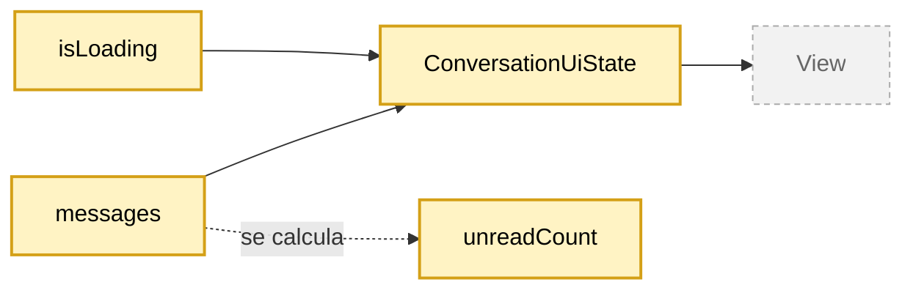

## ViewModel: estado + eventos

```kotlin
import androidx.lifecycle.ViewModel
import androidx.lifecycle.viewModelScope
import kotlinx.coroutines.flow.MutableStateFlow
import kotlinx.coroutines.flow.StateFlow
import kotlinx.coroutines.flow.asStateFlow
import kotlinx.coroutines.flow.update
import kotlinx.coroutines.launch

// Hereda de ViewModel para que lo creen y destruyan junto a la pantalla,
// y para tener viewModelScope.
// El repositorio entra por el constructor: así en un test se puede pasar uno falso.
class ConversationViewModel(
    private val repository: MessageRepository = MessageRepository(),
) : ViewModel() {

    // Patrón "backing property":
    // _uiState es MUTABLE y privado: solo el ViewModel puede escribir.
    private val _uiState = MutableStateFlow(ConversationUiState())

    // uiState es de SOLO LECTURA hacia fuera: la View observa, pero no puede asignar.
    val uiState: StateFlow<ConversationUiState> = _uiState.asStateFlow()

    // init se ejecuta al crear el ViewModel: la carga empieza sola al abrir la pantalla.
    init {
        loadMessages()
    }

    private fun loadMessages() {
        // viewModelScope se cancela solo cuando el ViewModel se destruye,
        // así que no queda ninguna corrutina huérfana (concurrencia estructurada).
        viewModelScope.launch {
            val loaded = repository.loadMessages()
            // update aplica el cambio de forma atómica sobre el valor actual.
            // copy crea un estado NUEVO: nunca se modifica el anterior.
            _uiState.update { it.copy(isLoading = false, messages = loaded) }
        }
    }

    // EVENTO: la View avisa de lo que ha pasado, y el ViewModel decide qué cambia.
    // El nombre describe lo que hizo el usuario (onMessageOpened), no lo que hay que hacer.
    fun onMessageOpened(id: Int) {
        _uiState.update { state ->
            state.copy(
                // map devuelve una lista nueva; solo el mensaje con ese id cambia.
                messages = state.messages.map { msg ->
                    if (msg.id == id) msg.copy(read = true) else msg
                }
            )
        }
    }
}
```

### `StateFlow` frente a `mutableStateOf` en el ViewModel

En [[Jetpack Compose UI Kotlin]] (apartado «`remember` vs `ViewModel`») el ViewModel usaba `var puntos by mutableIntStateOf(0)` con `private set`. Las dos formas son válidas:

| | `mutableStateOf` + `private set` | `MutableStateFlow` + `asStateFlow()` |
|---|---|---|
| Depende de | Compose runtime | Solo `kotlinx.coroutines` |
| Lectura en la View | Directa: `vm.puntos` | `vm.uiState.collectAsState()` |
| Fuera de Compose (tests, consola) | Incómodo | Natural: es un `Flow` |
| Combinar varias fuentes | Manual | `combine`, `map`, `stateIn` |
| Cuándo usarlo | Pantallas sencillas | Lo habitual en proyectos reales |

> [!danger] `remember` no existe en el ViewModel
> `remember` solo funciona dentro de un `@Composable`. El ViewModel ya sobrevive a las recomposiciones por sí mismo: no hace falta "recordarlo".

Flujo de este apartado: el evento entra, el estado se copia y sale por un flujo de solo lectura.

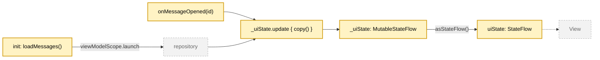

## View: observar el estado y enviar eventos

La View se divide en dos tipos de composable:

- **Screen (con estado):** obtiene el ViewModel, recoge su estado y lo pasa hacia abajo. Es la única que conoce al ViewModel.
- **Content (sin estado):** recibe datos y lambdas. No sabe que existe un ViewModel, así que se puede previsualizar y reutilizar.

```kotlin
import androidx.compose.runtime.collectAsState
import androidx.compose.runtime.getValue
import androidx.lifecycle.viewmodel.compose.viewModel

// SCREEN: el puente entre ViewModel y composables.
@Composable
fun ConversationScreen(
    // viewModel { } crea el ViewModel la primera vez y devuelve EL MISMO en cada
    // recomposición. Con ConversationViewModel() a secas se crearía uno nuevo
    // en cada recomposición y se perdería el estado (y se recargaría todo).
    viewModel: ConversationViewModel = viewModel { ConversationViewModel() },
) {
    // collectAsState convierte el StateFlow en State de Compose.
    // Leer uiState suscribe este composable: cuando el flujo emite, se recompone.
    val uiState by viewModel.uiState.collectAsState()

    // Hacia abajo bajan DATOS; hacia arriba suben EVENTOS (lambdas).
    // viewModel::onMessageOpened es una referencia a función: equivale a { id -> viewModel.onMessageOpened(id) }.
    ConversationContent(
        uiState = uiState,
        onMessageOpened = viewModel::onMessageOpened,
    )
}
```

```kotlin
// CONTENT: función pura de su estado. Sin ViewModel, sin repositorio.
@Composable
fun ConversationContent(
    uiState: ConversationUiState,
    onMessageOpened: (Int) -> Unit,
) {
    // when sobre el estado: cada caso es una pantalla distinta, y no hace falta
    // ninguna bandera de visibilidad (es el if de Kotlin del ejercicio 6 de Compose).
    when {
        uiState.isLoading -> CircularProgressIndicator(modifier = Modifier.padding(32.dp))
        uiState.messages.isEmpty() -> Text("No messages yet.", modifier = Modifier.padding(32.dp))
        else -> Column {
            Text(
                // Lee el dato derivado: no hay ningún contador que mantener.
                text = "Sin leer: ${uiState.unreadCount}",
                style = MaterialTheme.typography.titleMedium,
                modifier = Modifier.padding(16.dp),
            )
            LazyColumn {
                // key: Compose asocia cada fila a su id y no a su posición.
                // Si la lista se reordena, el remember de cada tarjeta viaja con su mensaje.
                items(uiState.messages, key = { it.id }) { message ->
                    MessageCard(
                        msg = message,
                        // La tarjeta no sabe qué es un id: solo avisa de que la abrieron.
                        onOpen = { onMessageOpened(message.id) },
                    )
                }
            }
        }
    }
}
```

> [!tip] En Android
> Cambia `collectAsState()` por `collectAsStateWithLifecycle()`: deja de recoger el flujo cuando la app pasa a segundo plano y ahorra batería.

Flujo de este apartado: el estado baja por parámetros y los eventos suben por lambdas (flujo unidireccional).

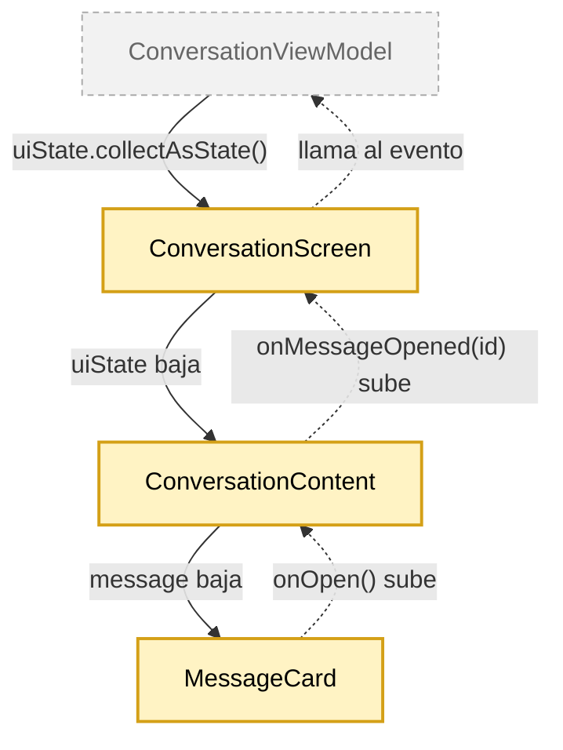

## Qué estado va en el ViewModel y cuál en `remember`

El ejercicio 9 de [[Compose Composición Kotlin]] («Dónde vive el estado») dejaba una pregunta: **¿a quién pertenece este estado?** MVVM no cambia la pregunta, añade una tercera respuesta posible.

| Estado | ¿A quién pertenece? | Dónde vive |
|---|---|---|
| «Esta tarjeta está desplegada» | A una tarjeta, solo afecta al dibujo | `remember` en `MessageCard` |
| «Este mensaje está leído» | A los datos: otras partes de la pantalla lo usan (`unreadCount`) | `ConversationUiState`, en el ViewModel |
| «Se están cargando los mensajes» | A la pantalla entera | `ConversationUiState`, en el ViewModel |

La prueba rápida: **si perderlo al cerrar y abrir la pantalla no importa y nadie más lo necesita, es estado de UI y va en `remember`**. Si no, va en el ViewModel.

```kotlin
@Composable
fun MessageCard(msg: Message, onOpen: () -> Unit) {
    // Estado de UI: solo esta tarjeta lo usa, así que no sube al ViewModel.
    var isExpanded by remember { mutableStateOf(false) }

    Column(
        modifier = Modifier
            .padding(16.dp)
            .clickable {
                isExpanded = !isExpanded
                // Al abrir, avisa hacia arriba. Se hace en el clic (un evento),
                // no durante la composición: así se respeta la regla de "sin efectos secundarios".
                if (isExpanded) onOpen()
            }
    ) {
        Text(
            text = msg.author,
            // Los datos eligen el rol del tema (ejercicio 10 de Compose Composición).
            color = if (msg.read) MaterialTheme.colorScheme.secondary
                    else MaterialTheme.colorScheme.primary,
            style = MaterialTheme.typography.titleMedium,
        )
        Spacer(Modifier.height(8.dp))
        Surface(
            shape = MaterialTheme.shapes.large,
            shadowElevation = 2.dp,
            modifier = Modifier.animateContentSize(),
        ) {
            Text(
                text = msg.body,
                modifier = Modifier.padding(4.dp),
                maxLines = if (isExpanded) Int.MAX_VALUE else 1,
                style = MaterialTheme.typography.bodyLarge,
            )
        }
    }
}
```

Flujo de este apartado: dos tipos de estado conviven en la misma tarjeta.

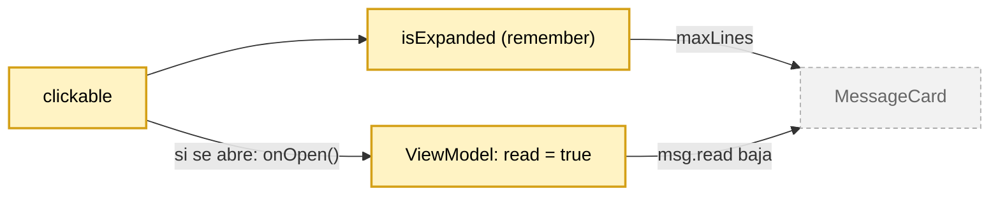

## Previews sin ViewModel

Como `ConversationContent` no conoce al ViewModel, la preview solo necesita un estado escrito a mano. Igual que en [[Compose Composición Kotlin#Previews]], la preview no tiene parámetros y fija los valores:

```kotlin
@Preview
@Composable
fun ConversationLoadedPreview() {
    MaterialTheme {
        ConversationContent(
            // Un estado inventado: no hace falta esperar a ninguna carga.
            uiState = ConversationUiState(
                isLoading = false,
                messages = listOf(
                    Message(1, "Eva", "Hola", read = true),
                    Message(2, "Josep", "Bon dia"),
                ),
            ),
            // Lambda vacía: en una preview los eventos no tienen que hacer nada.
            onMessageOpened = {},
        )
    }
}

@Preview
@Composable
fun ConversationLoadingPreview() {
    // El estado por defecto ya es "cargando".
    MaterialTheme { ConversationContent(ConversationUiState(), onMessageOpened = {}) }
}
```

Si la preview llamara a `ConversationScreen`, necesitaría crear un ViewModel, un repositorio y esperar un segundo. **Esa es la ventaja práctica de separar Screen y Content.**

Flujo de este apartado: la preview entra por Content y se salta el ViewModel.

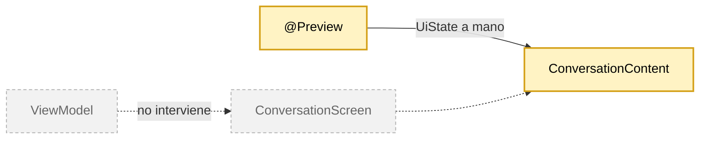

## Ejemplo completo

Reúne todo lo anterior en un solo `main.kt` para escritorio. Necesita el `module.yaml` del apartado de dependencias. En un proyecto real cada capa iría en su propio archivo (`Message.kt`, `MessageRepository.kt`, `ConversationViewModel.kt`, `ConversationScreen.kt`).

```kotlin
import androidx.compose.animation.animateContentSize
import androidx.compose.foundation.clickable
import androidx.compose.foundation.layout.Column
import androidx.compose.foundation.layout.Spacer
import androidx.compose.foundation.layout.fillMaxSize
import androidx.compose.foundation.layout.height
import androidx.compose.foundation.layout.padding
import androidx.compose.foundation.lazy.LazyColumn
import androidx.compose.foundation.lazy.items
import androidx.compose.material3.CircularProgressIndicator
import androidx.compose.material3.MaterialTheme
import androidx.compose.material3.Surface
import androidx.compose.material3.Text
import androidx.compose.runtime.Composable
import androidx.compose.runtime.collectAsState
import androidx.compose.runtime.getValue
import androidx.compose.runtime.mutableStateOf
import androidx.compose.runtime.remember
import androidx.compose.runtime.setValue
import androidx.compose.ui.Modifier
import androidx.compose.ui.unit.dp
import androidx.compose.ui.window.Window
import androidx.compose.ui.window.application
import androidx.lifecycle.ViewModel
import androidx.lifecycle.viewModelScope
import androidx.lifecycle.viewmodel.compose.viewModel
import kotlinx.coroutines.delay
import kotlinx.coroutines.flow.MutableStateFlow
import kotlinx.coroutines.flow.StateFlow
import kotlinx.coroutines.flow.asStateFlow
import kotlinx.coroutines.flow.update
import kotlinx.coroutines.launch

// ───────────── MODEL ─────────────

// id para poder identificar cada mensaje en los eventos y en el key de LazyColumn.
data class Message(val id: Int, val author: String, val body: String, val read: Boolean = false)

// Única puerta a los datos: el ViewModel no sabe si vienen de una lista o de una API.
class MessageRepository {
    private val messages = listOf(
        Message(1, "Josep Pla", "Antigament, el viatjar era un privilegi de gran senyor. Generalment, era la coronació normal dels estudis d'un home."),
        Message(2, "Josep Pla", "Però, potser, les persones que viatgen per arrodonir i afermar la seva visió del món són més rares avui que fa cent anys."),
        Message(3, "Eva", "En el pot petit hi ha la bona confitura."),
    )

    // Simula una carga lenta para que se vea el estado "cargando".
    suspend fun loadMessages(): List<Message> {
        delay(1000)
        return messages
    }
}

// ───────────── VIEWMODEL ─────────────

// Una sola foto de la pantalla. unreadCount se deriva, no se guarda.
data class ConversationUiState(
    val isLoading: Boolean = true,
    val messages: List<Message> = emptyList(),
) {
    val unreadCount: Int
        get() = messages.count { !it.read }
}

class ConversationViewModel(
    private val repository: MessageRepository = MessageRepository(),
) : ViewModel() {
    // Mutable y privado: solo el ViewModel escribe.
    private val _uiState = MutableStateFlow(ConversationUiState())
    // Solo lectura hacia fuera: la View observa.
    val uiState: StateFlow<ConversationUiState> = _uiState.asStateFlow()

    init {
        // viewModelScope: la carga se cancela si el ViewModel se destruye antes de acabar.
        viewModelScope.launch {
            val loaded = repository.loadMessages()
            _uiState.update { it.copy(isLoading = false, messages = loaded) }
        }
    }

    // Evento: el usuario abrió un mensaje. Se marca como leído creando un estado nuevo.
    fun onMessageOpened(id: Int) {
        _uiState.update { state ->
            state.copy(messages = state.messages.map { if (it.id == id) it.copy(read = true) else it })
        }
    }
}

// ───────────── VIEW ─────────────

@Composable
fun MessageCard(msg: Message, onOpen: () -> Unit) {
    // Estado de UI: solo pertenece a esta tarjeta.
    var isExpanded by remember { mutableStateOf(false) }

    Column(
        modifier = Modifier
            .padding(16.dp)
            .clickable {
                isExpanded = !isExpanded
                // El evento sube solo al abrir; cerrar no "desmarca" la lectura.
                if (isExpanded) onOpen()
            }
    ) {
        Text(
            text = msg.author,
            // Sin leer en color primario: el rol lo elige el dato, no un color literal.
            color = if (msg.read) MaterialTheme.colorScheme.secondary else MaterialTheme.colorScheme.primary,
            style = MaterialTheme.typography.titleMedium,
        )
        Spacer(Modifier.height(8.dp))
        Surface(
            shape = MaterialTheme.shapes.large,
            shadowElevation = 2.dp,
            modifier = Modifier.animateContentSize(),
        ) {
            Text(
                text = msg.body,
                modifier = Modifier.padding(4.dp),
                maxLines = if (isExpanded) Int.MAX_VALUE else 1,
                style = MaterialTheme.typography.bodyLarge,
            )
        }
    }
}

// Sin estado: recibe la foto de la pantalla y una lambda por evento.
@Composable
fun ConversationContent(uiState: ConversationUiState, onMessageOpened: (Int) -> Unit) {
    when {
        uiState.isLoading -> CircularProgressIndicator(modifier = Modifier.padding(32.dp))
        uiState.messages.isEmpty() -> Text("No messages yet.", modifier = Modifier.padding(32.dp))
        else -> Column {
            Text(
                text = "Sin leer: ${uiState.unreadCount}",
                style = MaterialTheme.typography.titleMedium,
                modifier = Modifier.padding(16.dp),
            )
            LazyColumn {
                // key = id: el remember de cada tarjeta sigue a su mensaje aunque cambie el orden.
                items(uiState.messages, key = { it.id }) { message ->
                    MessageCard(msg = message, onOpen = { onMessageOpened(message.id) })
                }
            }
        }
    }
}

// Con estado: el único composable que conoce al ViewModel.
@Composable
fun ConversationScreen(viewModel: ConversationViewModel = viewModel { ConversationViewModel() }) {
    val uiState by viewModel.uiState.collectAsState()
    ConversationContent(uiState = uiState, onMessageOpened = viewModel::onMessageOpened)
}

@Composable
fun App() {
    MaterialTheme {
        Surface(modifier = Modifier.fillMaxSize()) {
            // App ya no conoce los datos: solo coloca la pantalla.
            ConversationScreen()
        }
    }
}

// main solo abre la ventana, igual que en Compose Composición.
fun main() = application {
    Window(onCloseRequest = ::exitApplication, title = "Compose MVVM") {
        App()
    }
}
```

Flujo de este apartado: un ciclo completo desde el clic hasta el redibujado.

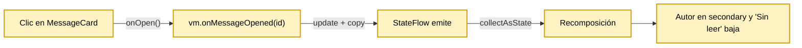

---

# Ejercicios Prácticos

## Ejercicio 1: ¿En qué capa va?

> [!NOTE]
> **📝 ENUNCIADO**
>
> Indica en qué capa (Model, ViewModel o View) va cada cosa:
> 1. Leer los mensajes de un archivo JSON.
> 2. Decidir que un mensaje borrado no se puede volver a abrir.
> 3. Que el autor se pinte en `titleMedium`.
> 4. El número de mensajes sin leer.
> 5. Si una tarjeta está desplegada.

> [!success]- Respuesta
> 1. **Model** (el repositorio): de dónde salen los datos.
> 2. **ViewModel**: es una regla que se aplica al recibir un evento.
> 3. **View**: es dibujo puro.
> 4. **ViewModel**, como dato derivado de `UiState` (`unreadCount`).
> 5. **View**, con `remember`: solo afecta al dibujo de esa tarjeta.
>
> **Explicación:** la pregunta para separar ViewModel de View es «¿esto cambiaría si la pantalla fuera un terminal de texto en vez de Compose?». Si la respuesta es no, no es de la View.

---

## Ejercicio 2: Solo lectura hacia fuera

> [!NOTE]
> **📝 ENUNCIADO**
>
> Un compañero borra `_uiState` y deja `val uiState = MutableStateFlow(ConversationUiState())` público. Compila y funciona. ¿Qué problema introduce? Escribe una línea en la View que lo demuestre.

> [!success]- Respuesta
> ```kotlin
> @Composable
> fun ConversationScreen(viewModel: ConversationViewModel = viewModel { ConversationViewModel() }) {
>     // Compila: la View puede cambiar el estado saltándose el ViewModel.
>     viewModel.uiState.value = ConversationUiState(isLoading = false)
> }
> ```
>
> **Explicación:** el estado tendría varios dueños. Cualquier composable podría escribir, y ya no habría un único sitio donde buscar «¿quién ha cambiado esto?». Además, escribir durante la composición es un efecto secundario. Con `_uiState` privado y `asStateFlow()` la línea no compila.

---

## Ejercicio 3: Marcar todo como leído

> [!NOTE]
> **📝 ENUNCIADO**
>
> Añade un botón «Marcar todo como leído» encima de la lista. Respeta las capas: el botón no puede tocar la lista directamente.

> [!success]- Respuesta
> ```kotlin
> // ViewModel: nuevo evento. Copia cada mensaje con read = true.
> fun onMarkAllRead() {
>     _uiState.update { state ->
>         state.copy(messages = state.messages.map { it.copy(read = true) })
>     }
> }
>
> // Content: una lambda más en la firma.
> @Composable
> fun ConversationContent(
>     uiState: ConversationUiState,
>     onMessageOpened: (Int) -> Unit,
>     onMarkAllRead: () -> Unit,
> ) {
>     // ... dentro del else, antes de la LazyColumn:
>     Button(onClick = onMarkAllRead, enabled = uiState.unreadCount > 0) {
>         Text("Marcar todo como leído")
>     }
> }
>
> // Screen: conecta la lambda con el ViewModel.
> ConversationContent(uiState, viewModel::onMessageOpened, viewModel::onMarkAllRead)
> ```
>
> **Explicación:** cada acción nueva del usuario sigue el mismo camino: función en el ViewModel, lambda en Content y conexión en Screen. `enabled` lee el dato derivado, así que el botón se desactiva solo.

---

## Ejercicio 4: No dupliques el contador

> [!NOTE]
> **📝 ENUNCIADO**
>
> Alguien cambia `unreadCount` por un campo normal: `val unreadCount: Int = 0`, y lo actualiza en `onMessageOpened`. Encuentra el fallo sin ejecutarlo.

> [!success]- Respuesta
> ```kotlin
> data class ConversationUiState(
>     val isLoading: Boolean = true,
>     val messages: List<Message> = emptyList(),
>     // MAL: es un dato que hay que mantener a mano.
>     val unreadCount: Int = 0,
> )
>
> // En loadMessages solo se copian isLoading y messages:
> _uiState.update { it.copy(isLoading = false, messages = loaded) }
> // → unreadCount se queda en 0 aunque haya 3 mensajes sin leer.
> ```
>
> **Explicación:** cada evento tendría que acordarse de recalcularlo, y la carga inicial ya se lo olvida. Un dato que se puede calcular a partir de otro **se calcula**, como en [[Jetpack Compose UI Kotlin]] (apartado «No dupliques estado»).

---

## Ejercicio 5: Sin suscripción no hay recomposición

> [!NOTE]
> **📝 ENUNCIADO**
>
> En `ConversationScreen` cambias `val uiState by viewModel.uiState.collectAsState()` por `val uiState = viewModel.uiState.value`. ¿Qué ves al abrir la app?

> [!success]- Respuesta
> ```kotlin
> // MAL: lee el valor una vez y no se suscribe al flujo.
> val uiState = viewModel.uiState.value
> ```
>
> **Explicación:** el indicador de carga se queda girando para siempre. `.value` es una lectura puntual de un `StateFlow`, no un `State` de Compose, así que Compose no sabe que tiene que volver a llamar a `ConversationScreen` cuando el flujo emite. `collectAsState()` es lo que crea la suscripción, igual que leer un `mutableStateOf` en [[Compose Composición Kotlin#Hacer que un mensaje se expanda]].

---

## Ejercicio 6: El ViewModel que se reinicia

> [!NOTE]
> **📝 ENUNCIADO**
>
> Cambias el parámetro por defecto de `ConversationScreen` a `viewModel: ConversationViewModel = ConversationViewModel()`. Abre un mensaje. ¿Qué pasa y por qué?

> [!success]- Respuesta
> ```kotlin
> // MAL: crea un ViewModel nuevo en cada recomposición.
> fun ConversationScreen(viewModel: ConversationViewModel = ConversationViewModel()) { ... }
>
> // BIEN: viewModel { } lo guarda y devuelve siempre la misma instancia.
> fun ConversationScreen(viewModel: ConversationViewModel = viewModel { ConversationViewModel() }) { ... }
> ```
>
> **Explicación:** al abrir el mensaje el estado cambia y se recompone `ConversationScreen`, lo que crea un ViewModel nuevo con `isLoading = true`. Vuelve a cargar un segundo y el mensaje aparece otra vez sin leer. Es el mismo error que un `mutableStateOf` sin `remember`, solo que con un objeto entero.

---

## Ejercicio 7: Una preview vacía

> [!NOTE]
> **📝 ENUNCIADO**
>
> Escribe una preview que muestre el caso «no hay mensajes» sin tocar el ViewModel ni el repositorio.

> [!success]- Respuesta
> ```kotlin
> @Preview
> @Composable
> fun ConversationEmptyPreview() {
>     MaterialTheme {
>         // isLoading = false y lista vacía: cae en la segunda rama del when.
>         ConversationContent(
>             uiState = ConversationUiState(isLoading = false, messages = emptyList()),
>             onMessageOpened = {},
>         )
>     }
> }
> ```
>
> **Explicación:** cualquier situación de la pantalla es un `UiState` que puedes escribir a mano. Probar el caso vacío con el ViewModel real te obligaría a modificar el repositorio.

---

## Ejercicio 8: Borrar un mensaje

> [!NOTE]
> **📝 ENUNCIADO**
>
> Añade un evento `onMessageDeleted(id: Int)` y un botón «Borrar» en cada tarjeta. Después, despliega el tercer mensaje y borra el primero. ¿Sigue desplegado el que tenías abierto? ¿Qué pasaría sin el `key` de `items`?

> [!success]- Respuesta
> ```kotlin
> // ViewModel: filter devuelve una lista nueva sin ese mensaje.
> fun onMessageDeleted(id: Int) {
>     _uiState.update { state -> state.copy(messages = state.messages.filter { it.id != id }) }
> }
>
> // MessageCard: un parámetro más, la tarjeta no sabe de ids.
> @Composable
> fun MessageCard(msg: Message, onOpen: () -> Unit, onDelete: () -> Unit) {
>     // ... dentro de la Column:
>     TextButton(onClick = onDelete) { Text("Borrar") }
> }
>
> // Content:
> items(uiState.messages, key = { it.id }) { message ->
>     MessageCard(
>         msg = message,
>         onOpen = { onMessageOpened(message.id) },
>         onDelete = { onMessageDeleted(message.id) },
>     )
> }
> ```
>
> **Explicación:** con `key` el mensaje desplegado sigue desplegado, porque su `remember` está atado a su id. Sin `key` el estado se asocia a la **posición**: al borrar el primero, todos suben un puesto y el desplegado pasa a ser otro mensaje.

---

## Ejercicio 9: Estado de error

> [!NOTE]
> **📝 ENUNCIADO**
>
> Haz que `loadMessages()` del repositorio lance `IllegalStateException("Sin conexión")`. Añade un campo `error: String?` al `UiState` y muestra el mensaje en pantalla en lugar de quedarse cargando.

> [!success]- Respuesta
> ```kotlin
> data class ConversationUiState(
>     val isLoading: Boolean = true,
>     val messages: List<Message> = emptyList(),
>     // null = no hay error. Nullable para no inventar un texto "vacío".
>     val error: String? = null,
> )
>
> // ViewModel: el try/catch va DENTRO del launch, que es donde ocurre la excepción.
> viewModelScope.launch {
>     try {
>         val loaded = repository.loadMessages()
>         _uiState.update { it.copy(isLoading = false, messages = loaded) }
>     } catch (e: IllegalStateException) {
>         _uiState.update { it.copy(isLoading = false, error = e.message) }
>     }
> }
>
> // Content: una rama más, la primera para que tenga prioridad.
> when {
>     uiState.error != null -> Text("Error: ${uiState.error}", color = MaterialTheme.colorScheme.error)
>     uiState.isLoading -> CircularProgressIndicator()
>     // ...
> }
> ```
>
> **Explicación:** el error es un estado más de la pantalla, no algo que la View tenga que capturar. Sin el `try/catch` la excepción cancelaría la corrutina (ver [[Coroutines Scope Kotlin#Manejo de errores]]) y la pantalla se quedaría cargando o la app se cerraría.

---

## Ejercicio 10: No pases el ViewModel hacia abajo

> [!NOTE]
> **📝 ENUNCIADO**
>
> Una alternativa «más corta» sería `fun MessageCard(msg: Message, viewModel: ConversationViewModel)` y llamar a `viewModel.onMessageOpened(msg.id)` dentro. Da tres motivos para no hacerlo.

> [!success]- Respuesta
> ```kotlin
> // MAL: la tarjeta queda atada a un ViewModel concreto.
> @Composable
> fun MessageCard(msg: Message, viewModel: ConversationViewModel) { ... }
>
> // BIEN: la tarjeta solo avisa; quien la usa decide qué significa.
> @Composable
> fun MessageCard(msg: Message, onOpen: () -> Unit) { ... }
> ```
>
> **Explicación:**
> 1. **Preview:** para dibujar una tarjeta necesitarías crear un ViewModel con su repositorio.
> 2. **Reutilización:** la tarjeta ya no sirve en otra pantalla con otro ViewModel.
> 3. **Responsabilidad:** la tarjeta conocería el `id` y la lógica de lectura. Con una lambda solo sabe que la abrieron.

---

## Proyecto: Diari con MVVM

> [!NOTE]
> **📝 ENUNCIADO**
>
> Convierte el proyecto **Diari** de [[Compose Composición Kotlin]] a MVVM:
>
> 1. **Model:** `data class Entry(val id: Int, val date: String, val title: String, val body: String, val favorite: Boolean = false)` y un `EntryRepository` con `suspend fun loadEntries()`.
> 2. **UiState:** `isLoading`, `entries` y un dato derivado `favoriteCount`.
> 3. **ViewModel:** carga en `init` con `viewModelScope` y un evento `onToggleFavorite(id)`.
> 4. **View:** `DiariScreen` (con ViewModel) y `DiariContent` (sin él), con `LazyColumn` y `key`.
> 5. Que la tarjeta desplegada siga en `remember` y el favorito en el ViewModel.
> 6. Dos previews de `DiariContent`: cargando y con datos.
>
> **Cómo saber que has terminado:** `DiariContent` y `EntryCard` no importan nada de `androidx.lifecycle`, y el ViewModel no importa nada de `androidx.compose`.

> [!tip]- Pistas (el proyecto no lleva solución: es para que lo practiques)
> - Copia la estructura del ejemplo completo y cambia `Message` por `Entry`.
> - `onToggleFavorite` es `map { if (it.id == id) it.copy(favorite = !it.favorite) else it }`.
> - Busca `import androidx.lifecycle` en los archivos de la View: si aparece fuera de `DiariScreen`, algo está en la capa equivocada.

---

# Cheatsheet

## Las capas

| Capa | Clase típica | Depende de |
|---|---|---|
| Model | `data class`, `Repository` | Nada de la interfaz |
| ViewModel | `class X : ViewModel()` + `data class XUiState` | Model, `kotlinx.coroutines` |
| View | `XScreen` (con ViewModel) + `XContent` (sin él) | ViewModel (solo `XScreen`) |

## ViewModel

| Elemento | Para qué sirve |
|---|---|
| `class X : ViewModel()` | Vive mientras viva la pantalla |
| `private val _uiState = MutableStateFlow(UiState())` | Estado mutable, solo el ViewModel escribe |
| `val uiState = _uiState.asStateFlow()` | Estado de solo lectura hacia fuera |
| `_uiState.update { it.copy(...) }` | Cambia el estado creando uno nuevo |
| `viewModelScope.launch { }` | Corrutina que se cancela con el ViewModel |
| `init { }` | Arranca la carga al crearse |
| `fun onAlgo(...)` | Un evento por cada acción del usuario |

## View

| Elemento | Para qué sirve |
|---|---|
| `viewModel { X() }` | Crea el ViewModel una vez y lo reutiliza |
| `vm.uiState.collectAsState()` | Suscribe el composable al `StateFlow` |
| `collectAsStateWithLifecycle()` | Igual, pero respeta el ciclo de vida (Android) |
| `vm::onAlgo` | Referencia a función para pasar como lambda |
| `items(lista, key = { it.id })` | El estado de cada fila sigue a su elemento |

## Dónde va cada estado

| Si el estado... | Va en |
|---|---|
| Solo afecta al dibujo de un composable | `remember { mutableStateOf() }` |
| Lo usan varias partes de la pantalla | `UiState` del ViewModel |
| Se puede calcular a partir de otro | Propiedad derivada (`get() = ...`) |
| Viene de fuera (archivo, red, base de datos) | Repositorio, y su resultado en `UiState` |

## Dependencias

| Plataforma | Biblioteca |
|---|---|
| Escritorio / multiplataforma | `org.jetbrains.androidx.lifecycle:lifecycle-viewmodel-compose` |
| Android | `androidx.lifecycle:lifecycle-viewmodel-compose` + `lifecycle-runtime-compose` |

---

# Esquema completo del flujo

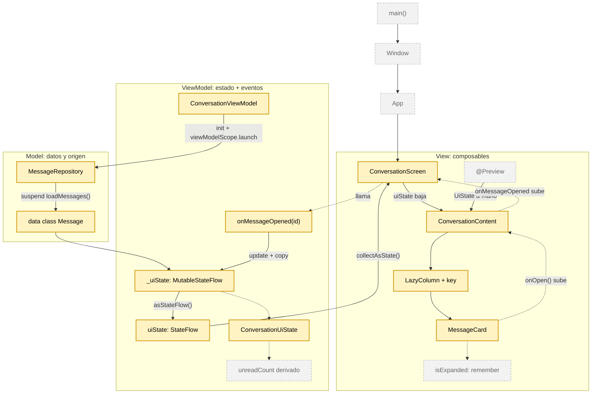

## La regla de oro

> **El estado baja, los eventos suben, y solo el ViewModel cambia el estado.**

Esta regla explica:
- Por qué `_uiState` es privado y `uiState` es de solo lectura.
- Por qué `MessageCard` recibe una lambda y no el ViewModel.
- Por qué `ConversationContent` se puede previsualizar con un estado inventado.

## Recuerda

1. **Tres capas, un solo sentido:** View → ViewModel → Model. Nunca al revés.
2. **Un `UiState` por pantalla:** una `data class` con todo lo que hay que dibujar.
3. **Derivado, no duplicado:** lo que se puede calcular (`unreadCount`) no se guarda.
4. **Mutable dentro, solo lectura fuera:** `_uiState` privado y `asStateFlow()`.
5. **Estado nuevo con `copy`:** `update { it.copy(...) }`, nunca modificar el anterior.
6. **`viewModel { }` y no el constructor:** si no, el ViewModel se recrea en cada recomposición.
7. **`collectAsState()` crea la suscripción:** `.value` lee una vez y no recompone.
8. **Screen con ViewModel, Content sin él:** Content se previsualiza y se reutiliza.
9. **Estado de UI en `remember`, estado de datos en el ViewModel:** pregúntate a quién pertenece.
10. **`key` en `items`:** el `remember` de cada fila sigue a su elemento y no a su posición.
