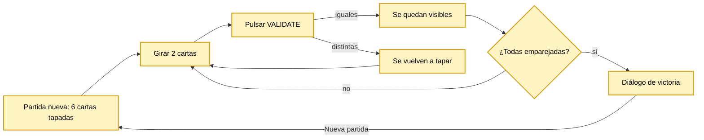
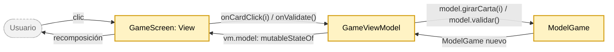
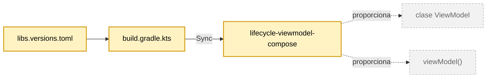
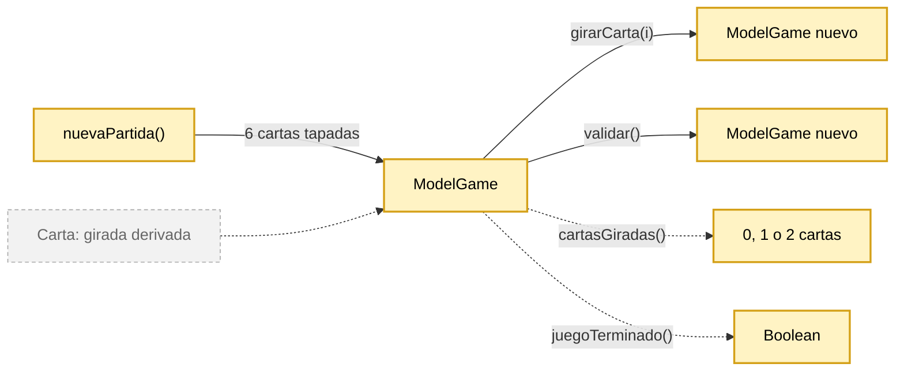
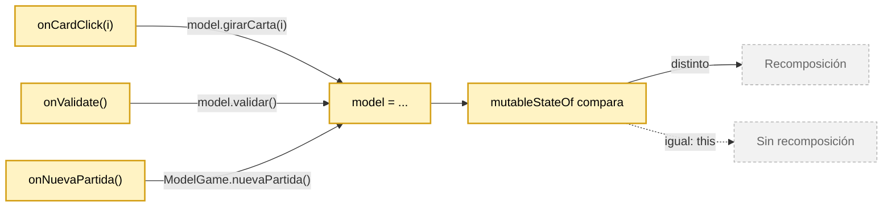
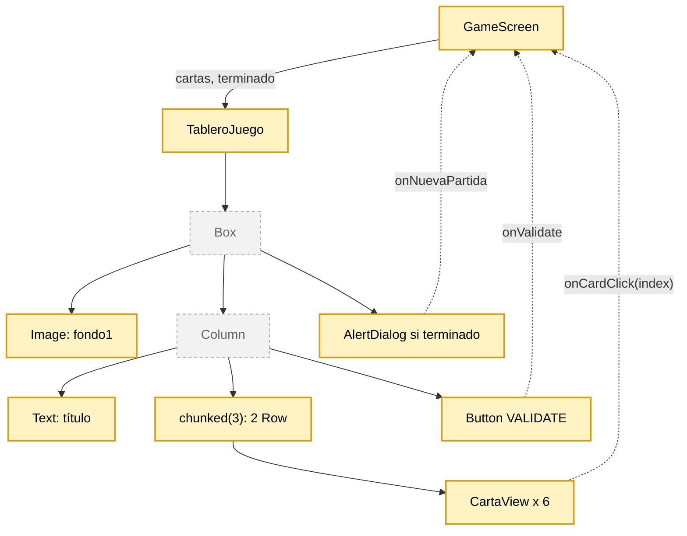
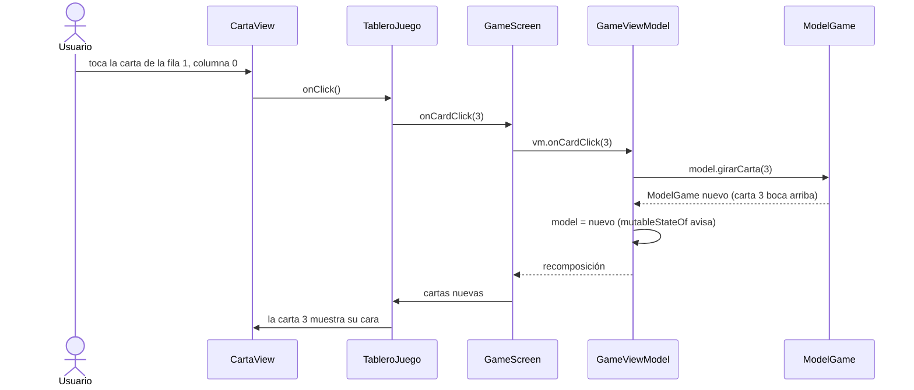
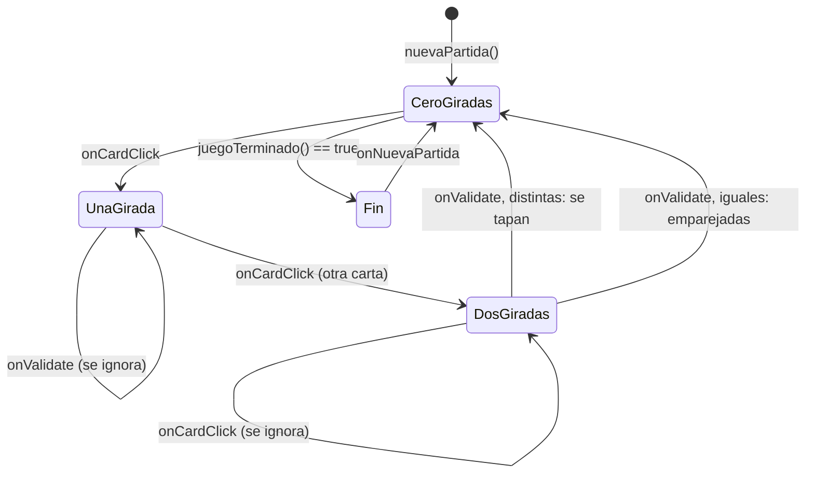
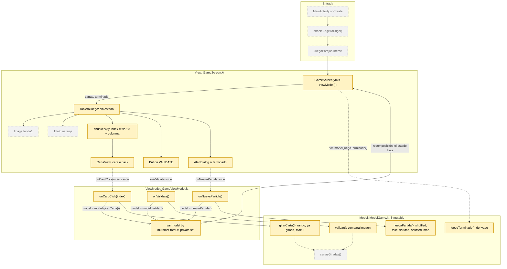

# Juego de Parejas: flujo y funcionamiento (MVVM + Compose)

Proyecto **JuegoParejas** (`dam2.mmo.juegoparejas`): un memory de 6 cartas hecho en Android con Jetpack Compose y arquitectura **MVVM**. Este documento explica qué hace cada archivo, cada método y cómo viaja una jugada desde el dedo del usuario hasta la pantalla.

Práctica de **DAM 2** (INS Provençana).

## Tecnologías

- **Kotlin** + **Jetpack Compose** (Material 3)
- Arquitectura **MVVM** con `androidx.lifecycle` (`ViewModel` + `viewModel()`)
- Android `minSdk 24`, `targetSdk 37`

## Cómo ejecutarlo

1. Clona el repositorio y abre la carpeta `JuegoParejas` en **Android Studio**.
2. Espera a que termine el *Gradle Sync*.
3. Ejecuta la configuración `app` en un emulador o en un móvil.

Desde la terminal también se puede compilar el APK de depuración:

```shell
./gradlew :app:assembleDebug
```

> [!NOTE]
> La carpeta `ejemplos/` contiene código de referencia de otro proyecto. Está fuera de `app/src` a propósito para que Gradle no la compile.

### Cómo leer los esquemas

- **Nodos amarillos:** clases, métodos o datos explicados en ese apartado.
- **Nodos grises discontinuos:** contexto de otros apartados.
- **Flecha continua:** se llama al método o los datos pasan al siguiente paso.
- **Flecha discontinua:** relación, consulta o consecuencia.

## El enunciado

Sale de `JOC Parelles.pdf`:

- Título **"Joc de les Parelles"**, **6 cartas** en 2 filas de 3 y un botón **VALIDATE**, sobre un fondo verde.
- Solo puede haber **2 cartas visibles** a la vez; después se pulsa VALIDATE.
- Si las dos son **iguales**, se quedan visibles. Si no, **se vuelven a tapar**.
- El juego **termina** cuando las 6 cartas están visibles.
- El PDF pide MVC; el proyecto se ha hecho con **MVVM**, la evolución natural en Compose.

Recursos en `res/drawable`: `back.png` (reverso), `chiquito.jpg`, `eugenio.jpg`, `faemino.jpg`, `rubianes.jpg` (caras) y `fondo1..4.jpg`. Con 6 cartas hay 3 parejas, así que se eligen 3 de las 4 caras al azar en cada partida.

Flujo de este apartado: el ciclo de una partida.



## Arquitectura: quién hace qué

| Capa | Archivo | Responsabilidad | ❌ No debe... |
|---|---|---|---|
| **Model** | `ModelGame.kt` | Datos y reglas puras: cartas, giros, validación, fin de partida | Importar nada de Compose |
| **ViewModel** | `GameViewModel.kt` | Guarda el estado observable y traduce eventos en llamadas al modelo | Conocer `@Composable`, `remember` ni `Modifier` |
| **View** | `GameScreen.kt` | Pinta el estado y avisa de los clics | Tener reglas del juego |
| **Entrada** | `MainActivity.kt` | `setContent { GameScreen() }` | Tener estado o lógica |

El flujo es **unidireccional**: los eventos **suben** (View → ViewModel → Model) y el estado **baja** (Model → ViewModel → View).

```text
app/src/main/
├── java/dam2/mmo/juegoparejas/
│   ├── MainActivity.kt      <- entrada
│   ├── GameScreen.kt        <- View
│   ├── GameViewModel.kt     <- ViewModel
│   ├── ModelGame.kt         <- Model
│   └── ui/theme/            <- Color.kt, Theme.kt, Type.kt
└── res/drawable/            <- back, caras y fondos
```

Flujo de este apartado: las tres capas y el sentido de los datos.



## Dependencias

`viewModel()` para Compose no viene en la plantilla. Se añade `lifecycle-viewmodel-compose` con **la misma versión** que `lifecycle-runtime-ktx`, porque todos los artefactos de `androidx.lifecycle` se publican juntos y mezclar versiones da conflictos.

```toml
# gradle/libs.versions.toml
[versions]
lifecycleRuntimeKtx = "2.11.0"

[libraries]
# Reutiliza la versión de lifecycleRuntimeKtx.
androidx-lifecycle-viewmodel-compose = { group = "androidx.lifecycle", name = "lifecycle-viewmodel-compose", version.ref = "lifecycleRuntimeKtx" }
```

```kotlin
// app/build.gradle.kts
dependencies {
    // Los guiones del .toml se convierten en puntos:
    // lifecycle-viewmodel-compose -> libs.androidx.lifecycle.viewmodel.compose
    implementation(libs.androidx.lifecycle.viewmodel.compose)
}
```

Después hay que hacer **Sync Gradle**.

Flujo de este apartado: la dependencia aporta las dos piezas de MVVM.



## Model: `ModelGame.kt`

Kotlin puro. La única importación es `@DrawableRes`, una anotación que comprueba que el `Int` es un drawable.

### Decisión clave: modelo inmutable

**Ninguna función cambia el objeto actual: todas devuelven un `ModelGame` nuevo** con `copy()`.

¿Por qué? Compose solo se entera de un cambio cuando cambia el **valor** del estado. Si hicieras `carta.bocaArriba = true` sobre la misma lista, la pantalla no se actualizaría. Con `copy()` siempre hay un objeto nuevo, y `mutableStateOf` lo detecta.

### `Carta`

```kotlin
data class Carta(
    @DrawableRes
    val imagen: Int,                  // la cara: R.drawable.chiquito, ...
    val bocaArriba: Boolean = false,  // true = se ve la cara; false = se ve back.png
    val emparejada: Boolean = false,  // true = ya acertada; validar() no la vuelve a tapar
) {
    // Propiedad DERIVADA: se calcula, no se guarda.
    // "Girada" = boca arriba pero aún sin pareja: las que el jugador está probando.
    val girada: Boolean get() = bocaArriba && !emparejada
}
```

- **`data class`:** da `copy()` y `equals()` gratis. `copy(bocaArriba = true)` crea la versión modificada.
- **Todos los campos `val`:** coherente con la inmutabilidad.
- **Una carta emparejada sigue con `bocaArriba = true`**: `validar()` solo cambia `emparejada`.

| Estado de la carta | `bocaArriba` | `emparejada` | `girada` | Se ve |
|---|---|---|---|---|
| Tapada | `false` | `false` | `false` | `back.png` |
| Girada (probando) | `true` | `false` | `true` | Su cara |
| Emparejada | `true` | `true` | `false` | Su cara |

### `ModelGame` y sus métodos

```kotlin
// Estado completo de la partida: las 6 cartas en orden de tablero.
// La posición en la lista (0..5) es el "index" que pasa la View.
data class ModelGame(
    val cartas: List<Carta> = emptyList(),
) {
    // Las cartas que el jugador está intentando emparejar ahora (0, 1 o 2).
    fun cartasGiradas(): List<Carta> = cartas.filter { it.girada }
    // ...
}
```

#### `girarCarta(index)`

```kotlin
fun girarCarta(index: Int): ModelGame {
    // 0. Índice fuera de rango -> nada. Sin esto, cartas[index] lanzaría
    //    IndexOutOfBoundsException (por ejemplo, con la lista vacía).
    if (index !in cartas.indices) return this

    val carta = cartas[index]

    // 1. Ya boca arriba o emparejada -> nada.
    //    Devolver "this" (la misma referencia) hace que Compose no recomponga.
    if (carta.bocaArriba || carta.emparejada) return this

    // 2. Ya hay 2 giradas pendientes de validar -> no se puede girar una tercera.
    //    Va después de la 1 porque recorre la lista (filter) y es más cara.
    if (cartasGiradas().size >= 2) return this

    // 3. Lista NUEVA donde solo cambia la carta pulsada.
    //    mapIndexed da el índice además de la carta.
    val nuevasCartas = cartas.mapIndexed { i, c ->
        if (i == index) c.copy(bocaArriba = true) else c
    }
    return copy(cartas = nuevasCartas)
}
```

Las comprobaciones van **en el Model y no en el ViewModel** porque son reglas del juego: así el ViewModel solo delega, y se pueden probar con un test unitario sin arrancar Android.

#### `validar()`

```kotlin
fun validar(): ModelGame {
    val giradas = cartasGiradas()
    // Validar con 0 o 1 carta no hace nada.
    if (giradas.size != 2) return this

    // Se compara por IMAGEN, no por índice: dos cartas son pareja
    // si muestran la misma cara, estén donde estén.
    val sonParejas = giradas[0].imagen == giradas[1].imagen

    // Recorre TODAS las cartas y solo toca las giradas.
    val nuevas = cartas.map { carta ->
        if (carta.girada) {
            if (sonParejas) carta.copy(emparejada = true)   // se quedan visibles
            else carta.copy(bocaArriba = false)             // se tapan
        } else carta                                        // el resto, igual
    }
    return copy(cartas = nuevas)
}
```

#### `juegoTerminado()`

```kotlin
fun juegoTerminado(): Boolean =
    // isNotEmpty() evita un falso positivo: emptyList().all { } devuelve true,
    // así que ModelGame() sin cartas contaría como partida ganada.
    cartas.isNotEmpty() && cartas.all { it.emparejada }
```

#### `nuevaPartida()` en el `companion object`

El `companion object` es lo que en Java sería `static`: se usa como **fábrica** para crear partidas con `ModelGame.nuevaPartida()` sin tener antes una instancia.

```kotlin
companion object {
    // Fuera de la función para poder pasar otras imágenes desde un test.
    val CARAS_DISPONIBLES = listOf(
        R.drawable.chiquito, R.drawable.eugenio, R.drawable.faemino, R.drawable.rubianes,
    )

    fun nuevaPartida(
        caras: List<Int> = CARAS_DISPONIBLES,
        parejas: Int = 3,
    ): ModelGame {
        // Sin esto, take(5) sobre 4 caras daría una partida más pequeña en silencio.
        require(parejas in 1..caras.size) {
            "parejas debe estar entre 1 y ${caras.size}, pero es $parejas"
        }

        val cartas = caras
            .shuffled()                                    // caras distintas cada partida
            .take(parejas)                                 // 3 de las 4
            .flatMap { imagen -> listOf(imagen, imagen) }  // [a,b,c] -> [a,a,b,b,c,c]
            .shuffled()                                    // si no, las parejas irían juntas
            .map { imagen -> Carta(imagen = imagen) }      // boca abajo y sin emparejar

        return ModelGame(cartas = cartas)
    }
}
```

| Paso | Ejemplo |
|---|---|
| `caras` | `[chiquito, eugenio, faemino, rubianes]` |
| `.shuffled().take(3)` | `[faemino, chiquito, rubianes]` |
| `.flatMap { listOf(it, it) }` | `[faemino, faemino, chiquito, chiquito, rubianes, rubianes]` |
| `.shuffled()` | `[chiquito, rubianes, faemino, chiquito, faemino, rubianes]` |
| `.map { Carta(it) }` | 6 `Carta` tapadas |

Flujo de este apartado: cada método recibe el modelo actual y devuelve uno nuevo.



## ViewModel: `GameViewModel.kt`

El "cable" entre View y Model: guarda el estado, recibe eventos y **delega** las reglas.

```kotlin
import androidx.compose.runtime.getValue
import androidx.compose.runtime.mutableStateOf
import androidx.compose.runtime.setValue
import androidx.lifecycle.ViewModel

// Hereda de ViewModel: Android lo conserva al girar la pantalla.
class GameViewModel : ViewModel() {

    // mutableStateOf: Compose vigila el valor y recompone a quien lo lea.
    // SIN remember: remember solo funciona dentro de un @Composable, y el
    //               ViewModel ya sobrevive a las recomposiciones por sí mismo.
    // by: permite escribir "model" en vez de "model.value" (getValue/setValue).
    // private set: la View lee, solo el ViewModel asigna -> un único dueño.
    // nuevaPartida() y no ModelGame(): el constructor vacío no tiene cartas.
    var model by mutableStateOf(ModelGame.nuevaPartida())
        private set

    // Patrón de TODOS los eventos: model = model.algunaFuncion(...)
    fun onCardClick(index: Int) {
        model = model.girarCarta(index)
    }

    fun onValidate() {
        model = model.validar()
    }

    // Sin "limpiar" nada: se sustituye el modelo por uno recién creado.
    fun onNuevaPartida() {
        model = ModelGame.nuevaPartida()
    }
}
```

### El patrón `model = model.algunaFuncion()`

Como `ModelGame` es inmutable, `model.girarCarta(index)` **no cambia `model`**: solo devuelve uno nuevo. Si no se asigna, el resultado se pierde y la pantalla no reacciona, sin ningún error. Pasa lo mismo que con `"hola".uppercase()` sin guardarlo en una variable.

Si `girarCarta` devuelve `this` (jugada no válida), se asigna el mismo objeto. `mutableStateOf` compara el valor nuevo con el anterior, ve que es igual y **no recompone**. Por eso no hace falta ningún `if` en el ViewModel.

### ¿Por qué no hay un evento ni una variable para `juegoTerminado`?

- **Un evento es algo que hace el usuario** (pulsar una carta, VALIDATE, "Nueva partida"). Nadie pulsa "terminar": el juego termina **como consecuencia** del estado.
- **`juegoTerminado()` es una pregunta sobre el estado**, y la respuesta siempre se puede calcular a partir de las cartas: es un **dato derivado**.
- **Lo pregunta la View** en cada recomposición: `vm.model.juegoTerminado()`.

Si se guardara como variable, habría **dos fuentes de verdad**:

```kotlin
var terminado by mutableStateOf(false)   // ❌ estado duplicado

fun onValidate() {
    model = model.validar()
    terminado = model.juegoTerminado()   // hay que acordarse aquí...
}

fun onNuevaPartida() {
    model = ModelGame.nuevaPartida()
    // ...y aquí. Si se olvida, la partida nueva sale como "ganada".
}
```

Calculándolo, **no se puede desincronizar**. Si un dato se puede calcular a partir del estado, no se guarda: se calcula.

### `mutableStateOf` o `StateFlow`

Se eligió la **opción A** (`mutableStateOf` + `private set`) porque es una sola pantalla y `GameScreen` lee `vm.model` directamente. La **opción B** (`MutableStateFlow` privado + `StateFlow` público + `collectAsState()`) es la habitual en proyectos grandes.

Flujo de este apartado: los tres eventos siguen el mismo patrón.



## View: `GameScreen.kt`

La pantalla se parte en dos niveles (**state hoisting**) más un composable para cada carta:

| Composable | Tipo | Qué hace |
|---|---|---|
| `GameScreen` | Con estado | Único que conoce el ViewModel. Hace de cable |
| `TableroJuego` | Sin estado | Recibe datos + lambdas y pinta toda la pantalla |
| `CartaView` | Sin estado | Pinta una carta y avisa del clic |

Ventajas de separar: la `@Preview` puede llamar a `TableroJuego` con cartas inventadas sin crear un ViewModel, y `TableroJuego` se puede reutilizar y testear.

### `GameScreen`

```kotlin
// viewModel() es el valor por defecto del PARÁMETRO:
// - Crea el GameViewModel la primera vez y luego devuelve SIEMPRE el mismo,
//   incluso al girar la pantalla. GameViewModel() a mano crearía uno nuevo
//   en cada recomposición y se perdería la partida.
// - MainActivity puede llamar a GameScreen() sin argumentos.
@Composable
fun GameScreen(vm: GameViewModel = viewModel()) {
    // Leer vm.model aquí suscribe a GameScreen: cuando el ViewModel asigna
    // un model nuevo, Compose vuelve a llamar a esta función.
    TableroJuego(
        cartas = vm.model.cartas,                       // el estado BAJA
        terminado = vm.model.juegoTerminado(),          // dato derivado
        onCardClick = { index -> vm.onCardClick(index) }, // los eventos SUBEN
        onValidate = vm::onValidate,                    // referencia de función
        onNuevaPartida = vm::onNuevaPartida,
    )
}
```

`vm::onValidate` es una **referencia a función**: equivale a `{ vm.onValidate() }`, pero más corta.

### `TableroJuego`

```kotlin
private const val COLUMNAS = 3                 // usado por chunked() Y por el índice
private val NARANJA = Color(0xFFFFA500)

@Composable
fun TableroJuego(
    cartas: List<Carta>,
    terminado: Boolean,
    onCardClick: (Int) -> Unit,
    onValidate: () -> Unit,
    onNuevaPartida: () -> Unit,
    modifier: Modifier = Modifier,             // el último: es el único con valor por defecto
) {
    // Box apila: primer hijo (fondo) DEBAJO, segundo (Column) ENCIMA.
    Box(modifier = modifier.fillMaxSize()) {

        // Fondo: Crop llena recortando sin deformar; null porque es decorativo.
        // Está fuera de la Column para que llegue detrás de las barras del sistema.
        Image(
            painter = painterResource(R.drawable.fondo1),
            contentDescription = null,
            contentScale = ContentScale.Crop,
            modifier = Modifier.fillMaxSize(),
        )

        Column(
            // safeDrawingPadding(): margen para las barras de estado y navegación,
            // necesario porque MainActivity activa enableEdgeToEdge().
            modifier = Modifier.fillMaxSize().safeDrawingPadding().padding(16.dp),
            horizontalAlignment = Alignment.CenterHorizontally,
            verticalArrangement = Arrangement.Center,
        ) {
            Text("Joc de les Parelles", color = NARANJA, fontSize = 28.sp, fontWeight = FontWeight.Bold)
            Spacer(Modifier.height(24.dp))

            // [c0..c5] -> [[c0,c1,c2], [c3,c4,c5]]
            cartas.chunked(COLUMNAS).forEachIndexed { fila, cartasDeLaFila ->
                Row(horizontalArrangement = Arrangement.spacedBy(8.dp)) {
                    cartasDeLaFila.forEachIndexed { columna, carta ->
                        // Índice REAL en la lista. "columna" sola va de 0 a 2 en
                        // CADA fila: la fila de abajo giraría las cartas de arriba.
                        val index = fila * COLUMNAS + columna
                        CartaView(carta = carta, onClick = { onCardClick(index) })
                    }
                }
                Spacer(Modifier.height(16.dp))
            }

            // No se desactiva con "enabled = hay 2 giradas": sería una regla
            // del juego en la View. El Model ya ignora validar con 0 o 1.
            Button(onClick = onValidate) { Text("VALIDATE") }
        }

        // El diálogo existe SOLO mientras terminado es true. Sin variable
        // "mostrarDialogo": al empezar partida nueva, juegoTerminado() pasa
        // a false y el diálogo desaparece solo.
        if (terminado) {
            AlertDialog(
                onDismissRequest = {},          // vacío: obliga a pulsar el botón
                title = { Text("¡Enhorabona!") },
                text = { Text("Has trobat totes les parelles.") },
                confirmButton = {
                    TextButton(onClick = onNuevaPartida) { Text("Nueva partida") }
                },
            )
        }
    }
}
```

**Cálculo del índice** (`fila * COLUMNAS + columna`):

| | columna 0 | columna 1 | columna 2 |
|---|---|---|---|
| **fila 0** | 0 | 1 | 2 |
| **fila 1** | 3 | 4 | 5 |

### `CartaView`

```kotlin
@Composable
fun CartaView(carta: Carta, onClick: () -> Unit, modifier: Modifier = Modifier) {
    // Con bocaArriba bastaría (las emparejadas siguen boca arriba);
    // "|| emparejada" asegura que una acertada nunca se vea tapada.
    val imagen = if (carta.bocaArriba || carta.emparejada) carta.imagen else R.drawable.back

    Image(
        painter = painterResource(imagen),
        contentDescription = if (carta.bocaArriba) "Carta girada" else "Carta tapada",
        contentScale = ContentScale.Crop,
        modifier = modifier
            .size(width = 100.dp, height = 150.dp)   // primero el tamaño...
            .clickable { onClick() },                // ...y la zona pulsable es la carta
    )
}
```

Las cartas emparejadas **no se bloquean en la View**: `girarCarta()` ya las ignora. La View no decide reglas.

### Previews

Usan `TableroJuego` con una lista **fija** (`cartasDeEjemplo`): `nuevaPartida()` baraja al azar y la preview saldría distinta cada vez.

- `TableroJuegoPreview`: tapadas, giradas y emparejadas a la vez.
- `TableroJuegoTerminadoPreview`: todas emparejadas y `terminado = true`, para ver el diálogo sin jugar.

Flujo de este apartado: el árbol de composables y por dónde suben los clics.



## Entrada: `MainActivity.kt`

```kotlin
// En MVVM la Activity solo es el punto de entrada: sin estado ni lógica.
class MainActivity : ComponentActivity() {
    override fun onCreate(savedInstanceState: Bundle?) {
        super.onCreate(savedInstanceState)
        // Dibuja detrás de las barras del sistema para que el fondo ocupe
        // toda la pantalla. Los márgenes los pone safeDrawingPadding().
        enableEdgeToEdge()
        setContent {
            // El tema aplica Material 3 a todo lo de dentro.
            // Sin Scaffold: no hay TopBar ni FAB y el fondo lo pone la pantalla.
            JuegoParejasTheme {
                GameScreen()
            }
        }
    }
}
```

Flujo de este apartado: del arranque a la primera pantalla.

```mermaid
flowchart LR
    ON["onCreate"]:::foco --> EDGE["enableEdgeToEdge()"]:::foco
    EDGE --> SET["setContent"]:::foco
    SET --> THEME["JuegoParejasTheme"]:::foco
    THEME --> GS["GameScreen()"]:::foco
    GS -.->|"viewModel() crea"| VM["GameViewModel"]:::ctx
    VM -.->|"init: nuevaPartida()"| M["ModelGame"]:::ctx

    classDef foco fill:#fff3c4,stroke:#d4a017,stroke-width:2px,color:#000
    classDef ctx fill:#f2f2f2,stroke:#aaa,stroke-dasharray:4 3,color:#666
```



## Recorrido completo de una jugada

### Pulsar una carta



### Pulsar VALIDATE con la última pareja

1. El botón llama a `onValidate` → `vm.onValidate()`.
2. `model = model.validar()` → todas las cartas quedan `emparejada = true`.
3. `model` es un `mutableStateOf`: Compose vuelve a llamar a `GameScreen`.
4. `GameScreen` vuelve a ejecutar `vm.model.juegoTerminado()`, que ahora devuelve `true`.
5. `TableroJuego` recibe `terminado = true` y muestra el `AlertDialog`.
6. "Nueva partida" → `vm.onNuevaPartida()` → `juegoTerminado()` vuelve a `false` y el diálogo desaparece.

### Estados de la partida



## Errores encontrados durante el desarrollo

| Dónde | Error | Por qué fallaba | Corrección |
|---|---|---|---|
| `GameViewModel` | `var model by remember { ... }` | `remember` solo funciona dentro de un `@Composable` | `var model by mutableStateOf(...)` con `private set` |
| `GameViewModel` | `model.girarCarta(index)` sin asignar | El modelo es inmutable: el resultado se perdía y la pantalla no cambiaba | `model = model.girarCarta(index)` |
| `GameViewModel` | Valor inicial `ModelGame()` | El constructor vacío no tiene cartas: pantalla vacía | `ModelGame.nuevaPartida()` |
| `GameViewModel` | `var newModel by mutableStateOf(...)` en `onNuevaPartida` | Creaba un segundo estado local que nadie observa | Asignar directamente a `model` |
| `GameViewModel` | `ModelGame(model.cartas)` para reiniciar | Copiaba las mismas cartas con su estado: no era una partida nueva | `ModelGame.nuevaPartida()` |
| `GameScreen` | `fun GameScreen(vm: GameViewModel): GameViewModel = viewModel() {` | Decía que la función devolvía un ViewModel, y `viewModel()` no era el valor por defecto | `fun GameScreen(vm: GameViewModel = viewModel())` |
| `ModelGame` | `mapIndexed { i, carta -> if (i == }` sin terminar | No compilaba y la función no devolvía nada | Ver `girarCarta` |
| `ModelGame` | `val ModelGame(cartas = ...)` | `val` declara una variable con nombre; la función necesita `return` | `return ModelGame(cartas = cartas)` |
| `ModelGame` | `TODO("...")` delante del `return` | `TODO()` lanza `NotImplementedError` siempre que se ejecuta | Borrar la línea del `TODO` |
| `ModelGame` | `cartas.all { }` sin más | `emptyList().all { }` devuelve `true` | `cartas.isNotEmpty() && ...` |
| Proyecto | `MVVM-separatModel.kt` en `src/main/java` | Era de otro proyecto (otro `R` y otro tema) y rompía el build | Movido a `JuegoParejas/ejemplos/` |
| Estilo | `if (x == true)` con un `Boolean` | Redundante | `if (x)` |

---

# Cheatsheet

## Métodos del Model

| Método | Devuelve | Qué hace |
|---|---|---|
| `Carta.girada` | `Boolean` | `bocaArriba && !emparejada` |
| `cartasGiradas()` | `List<Carta>` | Las cartas giradas sin pareja (0, 1 o 2) |
| `girarCarta(index)` | `ModelGame` | Gira una carta si las reglas lo permiten; si no, `this` |
| `validar()` | `ModelGame` | Empareja o tapa las 2 giradas; con 0 o 1, `this` |
| `juegoTerminado()` | `Boolean` | `isNotEmpty() && all { emparejada }` |
| `ModelGame.nuevaPartida(caras, parejas)` | `ModelGame` | 3 caras al azar, duplicadas, barajadas y tapadas |

## Eventos del ViewModel

| Evento | Lo dispara | Cuerpo |
|---|---|---|
| `onCardClick(index)` | `CartaView` | `model = model.girarCarta(index)` |
| `onValidate()` | Botón VALIDATE | `model = model.validar()` |
| `onNuevaPartida()` | Botón del diálogo | `model = ModelGame.nuevaPartida()` |

## Funciones de colecciones usadas

| Función | Ejemplo | Resultado |
|---|---|---|
| `filter { }` | `cartas.filter { it.girada }` | Solo las que cumplen |
| `map { }` | `cartas.map { it.copy(...) }` | Lista nueva transformada |
| `mapIndexed { i, x -> }` | Cambiar solo la posición `index` | Lista nueva con índice |
| `all { }` | `cartas.all { it.emparejada }` | `true` si todas cumplen (y si está vacía) |
| `shuffled()` | `caras.shuffled()` | Copia desordenada |
| `take(n)` | `take(3)` | Los `n` primeros |
| `flatMap { }` | `flatMap { listOf(it, it) }` | Duplica y aplana |
| `chunked(n)` | `cartas.chunked(3)` | Trozos de `n`: filas del tablero |
| `indices` | `index !in cartas.indices` | Rango de índices válidos |
| `require(cond) { msg }` | `require(parejas in 1..caras.size)` | Lanza `IllegalArgumentException` si falla |

## Compose usado

| Elemento | Para qué |
|---|---|
| `viewModel()` | Obtener siempre el mismo ViewModel |
| `mutableStateOf` + `by` + `private set` | Estado observable de solo lectura hacia fuera |
| `vm::onValidate` | Pasar un método como lambda |
| `Box` | Fondo debajo y contenido encima |
| `ContentScale.Crop` | Rellenar sin deformar |
| `safeDrawingPadding()` | Respetar las barras con `enableEdgeToEdge()` |
| `Arrangement.spacedBy(8.dp)` | Separación fija entre las cartas de una fila |
| `Modifier.size(...).clickable { }` | Carta pulsable de tamaño fijo |
| `AlertDialog` dentro de `if (terminado)` | Diálogo que depende del estado |

---

# Esquema completo del flujo



## La regla de oro

> **El Model decide, el ViewModel delega y guarda, la View pinta y avisa. Cada jugada es `model = model.algo()`.**

Esta regla explica:
- Por qué las comprobaciones de `girarCarta` están en el Model y no en el ViewModel ni en la View.
- Por qué olvidar el `model =` deja la pantalla quieta sin dar error.
- Por qué `juegoTerminado()` se pregunta y no se guarda.

## Recuerda

1. **Modelo inmutable:** cada función devuelve un `ModelGame` nuevo con `copy()`; nunca `carta.bocaArriba = true`.
2. **Asigna siempre el resultado:** `model = model.girarCarta(index)`. Sin el `model =`, no pasa nada.
3. **Devolver `this` = no recomponer:** las jugadas no válidas no redibujan la pantalla.
4. **Sin `remember` en el ViewModel:** `mutableStateOf` a secas y `private set`.
5. **`viewModel()` como valor por defecto del parámetro**, no `GameViewModel()` a mano.
6. **Datos derivados:** `girada` y `juegoTerminado()` se calculan; no se guardan en otra variable.
7. **Índice real del tablero:** `fila * COLUMNAS + columna`, no la `columna` de `chunked`.
8. **Comparar por imagen, no por índice:** dos cartas son pareja si muestran la misma cara.
9. **La View no decide reglas:** ni desactiva VALIDATE ni bloquea cartas; el Model ya lo ignora.
10. **`TODO()` lanza una excepción:** bórralo cuando implementes la función.
11. **`emptyList().all { }` es `true`:** añade `isNotEmpty()` cuando una lista vacía no deba contar.
12. **Solo el código del proyecto en `src/main/java`:** los ejemplos de otros proyectos rompen el build.
