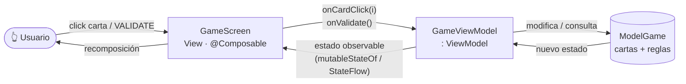
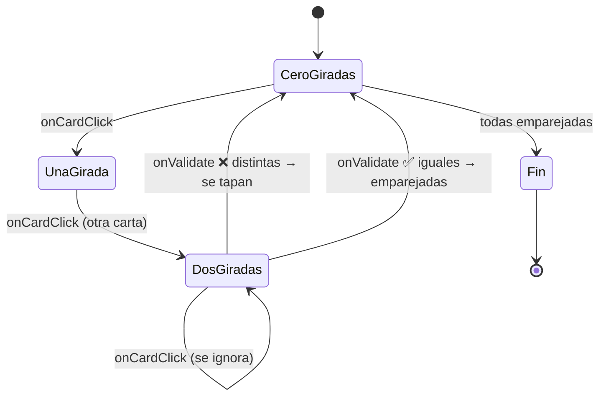
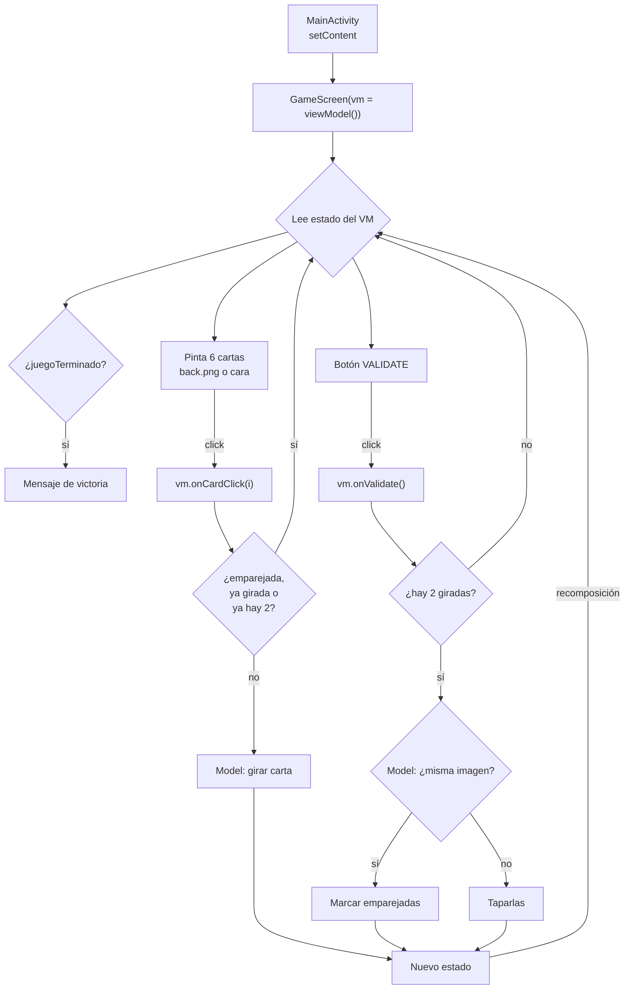

# 🃏 Juego de Parejas · Seguimiento MVVM

> [!info] Enunciado (`JOC Parelles.pdf`)
> - Pantalla con título **"Joc de les Parelles"**, **6 cartas** en 2 filas de 3 y un botón **VALIDATE**, sobre un fondo verde.
> - Solo se pueden dejar **2 cartas visibles** y después se pulsa **Validar**.
> - Si las dos cartas son **iguales** se quedan visibles; si no, **se vuelven a tapar**.
> - El juego **termina** cuando las 6 cartas están visibles.
> - El PDF pide **MVC** (Model + MainActivity). Nosotros lo haremos con **MVVM**, que es la evolución natural en Compose.

> [!tip] Recursos que ya tienes en `res/drawable`
> `back.png` (reverso) · `chiquito.jpg` · `eugenio.jpg` · `faemino.jpg` · `rubianes.jpg` · `fondo1..4.jpg`
> 6 cartas = **3 parejas**, así que necesitas 3 de las 4 caras (o eliges 3 al azar en cada partida: un buen extra).

---

## 1. Qué es MVVM aquí

| Capa | Archivo | Responsabilidad | ❌ NO debe… |
|---|---|---|---|
| **Model** | `ModelGame.kt` | Datos y reglas puras: las cartas, su estado, si ya hay pareja, si el juego ha acabado | importar nada de Compose ni de Android |
| **ViewModel** | `GameViewModel.kt` | Guarda el estado que observa la UI y traduce los eventos (`onCardClick`, `onValidate`) en llamadas al modelo | conocer `@Composable`, `remember` ni `Modifier` |
| **View** | `GameScreen.kt` | Pinta el estado y avisa al ViewModel cuando el usuario hace algo | tener lógica del juego (comparar cartas, contar parejas…) |
| **Entrada** | `MainActivity.kt` | Solo hace `setContent { GameScreen() }` | tener estado o lógica |

**La idea clave:** el flujo de datos es **unidireccional**. Los eventos *suben* (View → ViewModel) y el estado *baja* (ViewModel → View). La View nunca modifica el estado directamente.

---

## 2. Estado actual del código (27/10/2026)

| Archivo | Estado | Problema a corregir |
|---|---|---|
| `ModelGame.kt` | 🔴 Vacío | Falta todo |
| `GameViewModel.kt` | 🔴 No compila | Usa `remember` dentro de una clase normal. `remember` **solo** funciona dentro de un `@Composable`. Además no hereda de `ViewModel()` |
| `GameScreen.kt` | 🔴 Mal planteado | Es una `class` con una función que se llama igual. Debe ser una `@Composable fun GameScreen(...)` |
| `MainActivity.kt` | 🟡 Plantilla | Sobran `Greeting` y `GreetingPreview` |
| `build.gradle.kts` | 🟡 Falta dependencia | Para poder usar `viewModel()` en Compose necesitas `lifecycle-viewmodel-compose` |

---

## 3. Fases y checklist

### Fase 0 · Preparar el proyecto
- [ ] Añadir `androidx.lifecycle:lifecycle-viewmodel-compose` a `libs.versions.toml` y a `app/build.gradle.kts` (la misma versión que `lifecycleRuntimeKtx`).
- [ ] Hacer *Sync Gradle*.
- [ ] Limpiar `MainActivity`: quitar `Greeting`; dentro de `setContent` solo debe quedar el tema y `GameScreen()`.

### Fase 1 · Model (`ModelGame.kt`)
- [ ] Crear una `data class Carta` (o `Card`) con lo mínimo para identificarla:
  - qué imagen tiene (pista: `@DrawableRes val imagen: Int`)
  - si está **boca arriba**
  - si ya está **emparejada** (para que no se vuelva a girar al validar)
- [ ] En `ModelGame`, crear la lista de 6 cartas: 3 imágenes, **duplicadas** y **barajadas**.
  - Pista: `listOf(...)`, luego mira qué hacen `+`, `flatMap` o `repeat` para duplicar, y `.shuffled()`.
- [ ] Función que diga **cuántas cartas hay boca arriba sin emparejar** (te sirve para limitar a 2).
- [ ] Función que **compare** las 2 cartas giradas: si son iguales → marcarlas emparejadas; si no → taparlas.
- [ ] Función `juegoTerminado(): Boolean` → ¿están todas emparejadas? (pista: `all { ... }`).
- [ ] Función para **reiniciar** la partida (extra).

> [!question] Decisión de diseño a tomar
> ¿El modelo es **mutable** (cambias `carta.bocaArriba = true`) o **inmutable** (`copy(bocaArriba = true)` y devuelves una lista nueva)?
> Compose solo se entera de un cambio si **cambia la referencia** del estado. Con inmutable + `copy()` te ahorras muchos bugs de "he cambiado el dato y la pantalla no se actualiza".

### Fase 2 · ViewModel (`GameViewModel.kt`)
- [ ] `class GameViewModel : ViewModel()`.
- [ ] Guardar el estado observable **sin** `remember`:
  - Opción A (más sencilla): `var cartas by mutableStateOf(...)` con `private set`.
  - Opción B (la "profesional"): `private val _uiState = MutableStateFlow(...)` + `val uiState: StateFlow<...>`.
- [ ] `fun onCardClick(index: Int)`:
  - ignorar si la carta ya está emparejada o boca arriba
  - ignorar si ya hay 2 cartas giradas
  - si no, girarla
- [ ] `fun onValidate()`:
  - solo hace algo si hay exactamente 2 cartas giradas
  - delega en el modelo la comparación
- [ ] Exponer si el juego ha terminado para que la View muestre un mensaje.

### Fase 3 · View (`GameScreen.kt`)
- [ ] `@Composable fun GameScreen(vm: GameViewModel = viewModel())`.
- [ ] Fondo con `Image(painterResource(R.drawable.fondoX), contentScale = ContentScale.Crop)` dentro de un `Box`.
- [ ] Título "Joc de les Parelles" en naranja.
- [ ] 2 filas de 3 cartas. Pista: ya lo hiciste en el **Trilero** con `chunked(3)` → `Column { chunks.forEach { Row { ... } } }`.
- [ ] Cada carta: `Image` con `back.png` o con su cara según el estado, y `Modifier.clickable { vm.onCardClick(i) }`.
- [ ] Botón **VALIDATE** → `vm.onValidate()`.
- [ ] Mensaje de victoria cuando el juego termine (`Text`, `AlertDialog` o `Snackbar`).

### Fase 4 · Pruebas y extras
- [ ] Probar: girar 3 cartas (la 3ª no debe girarse).
- [ ] Probar: validar con 1 sola carta girada (no debe pasar nada).
- [ ] Probar: girar la pantalla → el estado **no** se pierde (gracias al `ViewModel`).
- [ ] Test unitario de `ModelGame` en `src/test` (sin Android, porque el modelo es Kotlin puro).
- [ ] Extra: botón "Nueva partida", contador de intentos, imágenes aleatorias.

---

## 4. Esquema completo

---

## 5. Diario de progreso

| Fecha | Qué he hecho | Dudas / problemas |
|---|---|---|
| 27/10/2026 | Proyecto creado, imágenes en `drawable`, esqueleto inicial de 4 archivos | `remember` en el ViewModel no compila → ver Fase 2 |
| | | |
| | | |

---

## 6. Recuerda

- `remember` → **solo** dentro de `@Composable`. En el ViewModel se usa `mutableStateOf` o `StateFlow` a secas.
- El ViewModel **sobrevive** a girar la pantalla; `remember` no.
- La View **no decide nada**: solo pinta y avisa con eventos.
- El Model es **Kotlin puro**: si importa `androidx.compose`, algo está mal. La excepción es `@DrawableRes`, que solo es una anotación.
- Para que Compose recomponga, cambia la **referencia** del estado (lista nueva / `copy()`), no solo un campo interno.
- `viewModel()` crea el ViewModel la primera vez y luego lo reutiliza. `GameViewModel()` crearía uno nuevo en cada recomposición.
