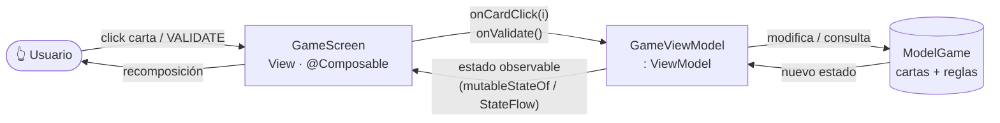
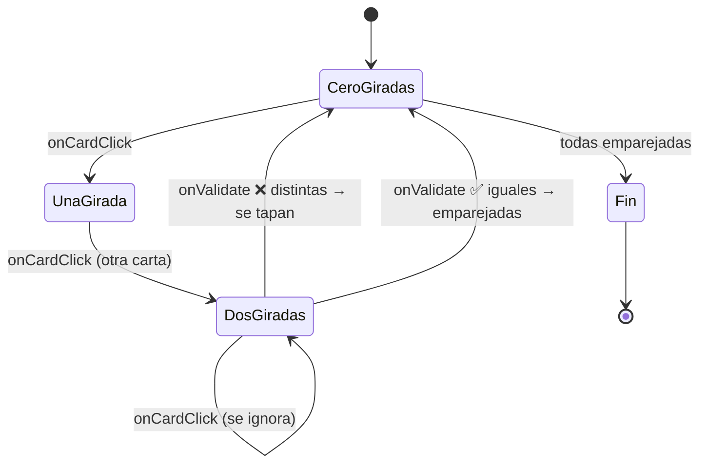
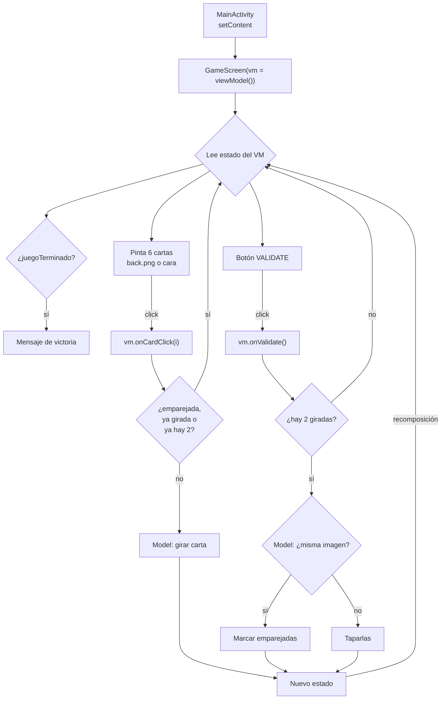

# 🃏 Juego de Parejas · Seguimiento MVVM

> [!info] Enunciado (`JOC Parelles.pdf`)
> - Pantalla con título **"Joc de les Parelles"**, **6 cartas** en 2 filas de 3 y un botón **VALIDATE**, sobre un fondo verde.
> - Solo se pueden dejar **2 cartas visibles** y después se pulsa **Validar**.
> - Si las dos cartas son **iguales** se quedan visibles; si no, **se vuelven a tapar**.
> - El juego **termina** cuando las 6 cartas están visibles.
> - El PDF pide **MVC** (Model + MainActivity). Nosotros lo haremos con **MVVM**, que es la evolución natural en Compose.

> [!tip] Recursos que ya tienes en `res/drawable`
> `back.png` (reverso) · `chiquito.jpg` · `eugenio.jpg` · `faemino.jpg` · `rubianes.jpg` · `fondo1..4.jpg`
> 6 cartas = **3 parejas**, así que necesitas 3 de las 4 caras (o eliges 3 al azar en cada partida: un buen extra).

---

## 1. Qué es MVVM aquí

| Capa | Archivo | Responsabilidad | ❌ NO debe… |
|---|---|---|---|
| **Model** | `ModelGame.kt` | Datos y reglas puras: las cartas, su estado, si ya hay pareja, si el juego ha acabado | importar nada de Compose ni de Android |
| **ViewModel** | `GameViewModel.kt` | Guarda el estado que observa la UI y traduce los eventos (`onCardClick`, `onValidate`) en llamadas al modelo | conocer `@Composable`, `remember` ni `Modifier` |
| **View** | `GameScreen.kt` | Pinta el estado y avisa al ViewModel cuando el usuario hace algo | tener lógica del juego (comparar cartas, contar parejas…) |
| **Entrada** | `MainActivity.kt` | Solo hace `setContent { GameScreen() }` | tener estado o lógica |

**La idea clave:** el flujo de datos es **unidireccional**. Los eventos *suben* (View → ViewModel) y el estado *baja* (ViewModel → View). La View nunca modifica el estado directamente.

---

## 2. Estado actual del código (27/10/2026)

| Archivo | Estado | Problema a corregir |
|---|---|---|
| `ModelGame.kt` | 🟡 En progreso (3/5) | `cartasGiradas()` y `validar()` hechas ✅ · `girarCarta()` a medias y **no compila** · faltan `juegoTerminado()` y `nuevaPartida()` |
| `GameViewModel.kt` | 🔴 No compila | Usa `remember` dentro de una clase normal. `remember` **solo** funciona dentro de un `@Composable`. Además no hereda de `ViewModel()` |
| `GameScreen.kt` | 🟡 Esqueleto | `GameScreen` / `TableroJuego` / `CartaView` + preview. Faltan los `TODO` (Fase 3) |
| `MainActivity.kt` | 🟢 Limpio (Fase 0) | Solo tema + `GameScreen()` |
| `build.gradle.kts` | 🟢 Hecho (Fase 0) | `lifecycle-viewmodel-compose` añadido |

---

## 3. Fases y checklist

### Fase 0 · Preparar el proyecto
- [x] Añadir `androidx.lifecycle:lifecycle-viewmodel-compose` a `libs.versions.toml` y a `app/build.gradle.kts` (la misma versión que `lifecycleRuntimeKtx`).
- [x] Hacer *Sync Gradle*. Resuelve `lifecycle-viewmodel-compose:2.11.0`.
- [x] Limpiar `MainActivity`: quitar `Greeting`; dentro de `setContent` solo debe quedar el tema y `GameScreen()`.

> [!warning] El proyecto todavía no compila
> Es lo esperado: `GameViewModel` usa `remember` (se arregla en la Fase 2) y `girarCarta()` está a medias (Fase 1). `GameScreen` ya es una `@Composable` (esqueleto de la Fase 3).
> Android Studio puede pedirte también un *Sync Now*, porque el sync lo he hecho por terminal.

### Fase 1 · Model (`ModelGame.kt`)
> [!note] Esqueleto preparado en `ModelGame.kt`
> Las firmas y las estructuras de datos ya están hechas. Tú rellenas los `TODO("...")`; cada uno lleva sus pistas en comentarios.

- [x] Crear una `data class Carta` con `imagen` (`@DrawableRes`), `bocaArriba` y `emparejada`. *(hecho en el esqueleto)*
- [x] Propiedad calculada `Carta.girada` (`bocaArriba && !emparejada`): la regla de "carta girada" está escrita en **un solo sitio**.
- [ ] `nuevaPartida()` (en el `companion object`): 3 imágenes, **duplicadas**, **barajadas** y convertidas en `Carta`.
  - Pista: `take`, `flatMap { listOf(it, it) }`, `shuffled()`, `map { Carta(it) }`.
- [x] `cartasGiradas()`: `cartas.filter { it.girada }`.
- [ ] `girarCarta(index)`: respetar las reglas y devolver un `ModelGame` nuevo (`mapIndexed` + `copy`). **En progreso**, pendiente:
  - [x] Regla 1: no girar si ya está boca arriba o emparejada (`return this`).
  - [ ] Regla 2: no girar si ya hay 2 cartas giradas (`cartasGiradas().size`).
  - [ ] `cartas.mapIndexed[index]` no es válido: `mapIndexed` recibe una lambda `{ i, carta -> ... }`, no un índice entre corchetes.
  - [ ] Falta el `return copy(cartas = ...)` final (ahora la función no devuelve nada en el `else`).
  - Plantilla: es el mismo patrón que `validar()`, pero con `mapIndexed` para saber la posición.
- [x] `validar()`: si las 2 imágenes son iguales → emparejadas; si no → se tapan. *(revisada 2 veces: `map` + `copy` + `return copy(cartas = nuevas)`)*
- [ ] `juegoTerminado()`: `all { it.emparejada }`. Cuidado con la lista vacía.
- [x] Reiniciar la partida → basta con volver a llamar a `ModelGame.nuevaPartida()`. *(sale gratis del diseño)*

> [!check] Decisión de diseño tomada: modelo **inmutable**
> `Carta` y `ModelGame` son `data class` con todos los campos `val`. Cada jugada (`girarCarta`, `validar`) **devuelve un `ModelGame` nuevo** con `copy()`.
> Así, en la Fase 2, el ViewModel solo tendrá que hacer `model = model.girarCarta(i)`. La referencia cambia y Compose recompone solo.

### Fase 2 · ViewModel (`GameViewModel.kt`)
- [ ] `class GameViewModel : ViewModel()`.
- [ ] Guardar el estado observable **sin** `remember`:
  - Opción A (más sencilla): `var cartas by mutableStateOf(...)` con `private set`.
  - Opción B (la "profesional"): `private val _uiState = MutableStateFlow(...)` + `val uiState: StateFlow<...>`.
- [ ] `fun onCardClick(index: Int)`:
  - ignorar si la carta ya está emparejada o boca arriba
  - ignorar si ya hay 2 cartas giradas
  - si no, girarla
- [ ] `fun onValidate()`:
  - solo hace algo si hay exactamente 2 cartas giradas
  - delega en el modelo la comparación
- [ ] Exponer si el juego ha terminado para que la View muestre un mensaje.

### Fase 3 · View (`GameScreen.kt`)
> [!note] Esqueleto preparado en `GameScreen.kt` (*state hoisting*)
> - `GameScreen(vm = viewModel())` → **con estado**: solo conecta el ViewModel con el tablero.
> - `TableroJuego(cartas, terminado, onCardClick, onValidate)` → **sin estado**: solo pinta.
> - `CartaView(carta, onClick)` → una carta.
> - `TableroJuegoPreview()` → preview con 6 cartas inventadas. No necesita ViewModel ni la Fase 1.
>
> Las subfases 3.1–3.6 **se pueden hacer ya** viendo la preview. Lo único que depende de la Fase 2 es conectar `GameScreen`.

- [x] `@Composable fun GameScreen(vm: GameViewModel = viewModel())`. *(firma en el esqueleto)*
- [ ] **3.1** Fondo: `Image(painterResource(R.drawable.fondoX), contentScale = ContentScale.Crop)` como primer hijo del `Box`.
- [ ] **3.2** Título "Joc de les Parelles" en naranja.
- [ ] **3.3** 2 filas de 3 cartas con `chunked(3)` (como en el **Trilero**). ⚠ Calcula bien el índice global `0..5`.
- [ ] **3.4** Botón **VALIDATE** → `onValidate`.
- [ ] **3.5** Mensaje de victoria si `terminado`.
- [ ] **3.6** `CartaView`: `back.png` o la cara según el estado + `clickable`.
- [ ] **Conectar** `GameScreen` → `TableroJuego` (necesita la Fase 2 hecha).

### Fase 4 · Pruebas y extras
- [ ] Probar: girar 3 cartas (la 3ª no debe girarse).
- [ ] Probar: validar con 1 sola carta girada (no debe pasar nada).
- [ ] Probar: girar la pantalla → el estado **no** se pierde (gracias al `ViewModel`).
- [ ] Test unitario de `ModelGame` en `src/test` (sin Android, porque el modelo es Kotlin puro).
- [ ] Extra: botón "Nueva partida", contador de intentos, imágenes aleatorias.

---

## 4. Esquema completo

---

## 5. Diario de progreso

| Fecha | Qué he hecho | Dudas / problemas |
|---|---|---|
| 27/10/2026 | Proyecto creado, imágenes en `drawable`, esqueleto inicial de 4 archivos | `remember` en el ViewModel no compila → ver Fase 2 |
| 27/10/2026 | **Fase 0 ✅**: dependencia `lifecycle-viewmodel-compose` añadida y resuelta; `MainActivity` limpia (sin `Scaffold` ni `Greeting`) | No compila hasta acabar las Fases 2 y 3 |
| 27/10/2026 | Esqueleto de la Fase 1 en `ModelGame.kt` (modelo inmutable) | |
| 27/10/2026 | Esqueleto de la Fase 3 en `GameScreen.kt` (con estado / sin estado + preview) | Quitado el `Layout()`: es una función interna de Compose, no nuestra |
| 27/10/2026 | Apuntes de Compose en `ApuntesRandom/Jetpack Compose UI Kotlin.md` (imágenes, layouts, eventos, estado) | |
| 27/10/2026 | `validar()` ✅ (2ª revisión), `cartasGiradas()` ✅, propiedad `Carta.girada` añadida | 1ª versión: `this` sin `return`, `forEach` en vez de `map`, `cartas.copy()` sobre una `List`, reasignar un `val`. 2ª: errata `bocarriba`. **Aprendido:** `map` transforma y `forEach` solo recorre; `copy()` solo existe en las `data class` |
| 27/10/2026 | `girarCarta()` empezada | `mapIndexed[index]` no existe; faltan la regla de 2 giradas y el `return` final |
| | | |

---

## 6. Recuerda

- `remember` → **solo** dentro de `@Composable`. En el ViewModel se usa `mutableStateOf` o `StateFlow` a secas.
- El ViewModel **sobrevive** a girar la pantalla; `remember` no.
- La View **no decide nada**: solo pinta y avisa con eventos.
- El Model es **Kotlin puro**: si importa `androidx.compose`, algo está mal. La excepción es `@DrawableRes`, que solo es una anotación.
- Para que Compose recomponga, cambia la **referencia** del estado (lista nueva / `copy()`), no solo un campo interno.
- `viewModel()` crea el ViewModel la primera vez y luego lo reutiliza. `GameViewModel()` crearía uno nuevo en cada recomposición.
- *State hoisting*: un composable **con estado** (conoce el ViewModel) llama a uno **sin estado** (recibe datos y lambdas). El que no tiene estado se puede previsualizar y reutilizar.
