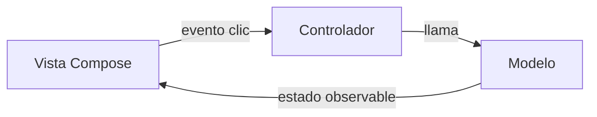

# Seguimiento MVC - Trilero (Compose)

Registro de lo que se va haciendo en la app. Actualizar tras cada sesión.

## Arquitectura

| Capa | Archivo | Responsabilidad |
|------|---------|-----------------|
| Modelo | `src/main/java/dam2/mmo/firstapp/Modelo.kt` | Estado del juego y reglas (sin UI) |
| Controlador | `src/main/java/dam2/mmo/firstapp/Controlador.kt` | Conecta Vista y Modelo, recibe eventos |
| Vista | `src/main/java/dam2/mmo/firstapp/ComposeTestActivity.kt` | Composables (`trileroGame`) |

## Modelo (`Modelo.kt`)

Estado: `modo`, `estado` (`EstadoJuego`), `posicionBola`, `seleccion`, `aciertos`, `fallos`; derivado: `numCubiletes`.

- [x] Esqueleto con estado observable (`mutableStateOf`) y enum `EstadoJuego`
- [x] `resultado(seleccion, posicion)` (ya implementada)
- [ ] `iniciarPartida()`
- [ ] `terminarBarajado()`
- [ ] `elegir(posicion)`
- [ ] `cambiarModo()`
- [ ] `reiniciar()`
- [ ] Tests unitarios del Modelo

## Controlador (`Controlador.kt`)

- [x] Quitar `ImageView`/`View.OnClickListener` (son de Views, no de Compose)
- [x] Esqueleto como `ViewModel` con las acciones de la Vista
- [ ] `onStartClick()`
- [ ] `onBarajadoTerminado()`
- [ ] `onCubileteClick(posicion)`
- [ ] `onCambiarModoClick()`
- [ ] `onReiniciarClick()`
- [ ] Obtenerlo en la Vista con `viewModel()` (requiere la dependencia `lifecycle-viewmodel-compose`)

## Vista (`ComposeTestActivity.kt`)

- [ ] Leer el estado del Modelo en `trileroGame` (3 o 6 cubiletes con `repeat`)
- [ ] Conectar `clickable` y botón Start al Controlador
- [ ] Mostrar aciertos/fallos y resultado de la jugada
- [ ] Animación de barajado
- [x] Eliminar el `FirstAppTheme` con `TODO()` duplicado (choca con el del paquete `ui.theme`)
- [x] Maquetación: cubiletes centrados en fila (`Box` + `align(Center)`) y botón Start abajo (`align(BottomCenter)`)
- [x] Añadir un cubo al hacer clic: lista `mutableStateListOf` + función local `addCubo()` (provisional, en la Vista)
- [ ] Mover la lógica de añadir/quitar cubos al Modelo/Controlador (ahora vive en la Vista, rompe MVC)
- [ ] Limitar el nº de cubos (la fila se sale de pantalla si hay muchos)

## Registro de sesiones

| Fecha | Qué se hizo |
|-------|-------------|
| 2026-10-20 | Creado esqueleto del Modelo con TODOs y este archivo de seguimiento |
| 2026-10-20 | Creado esqueleto del Controlador como `ViewModel` con TODOs |
| 2026-10-20 | Vista: layout centrado y clic que añade cubos. Errores corregidos: `fun addCubos() = { }` devolvía una lambda sin ejecutarla, llaves mal cerradas, 3 `Image` fijas duplicadas con el `forEach`, composable de preview anidado |

### Lección: `fun f() = { ... }` vs `fun f() { ... }`

- `fun f() = { ... }` → devuelve una lambda; el código de dentro NO se ejecuta al llamar a `f()`.
- `fun f() { ... }` → ejecuta el cuerpo al llamarla.
- Para que Compose redibuje al cambiar una lista, ha de ser observable (`mutableStateListOf`) o reasignarse a un `mutableStateOf`.

## Recuerda

- El Modelo no importa nada de `androidx.compose.ui` ni de `android.view`; solo el estado de `runtime`.
- Marca cada casilla al terminar y añade una fila al registro de sesiones.
