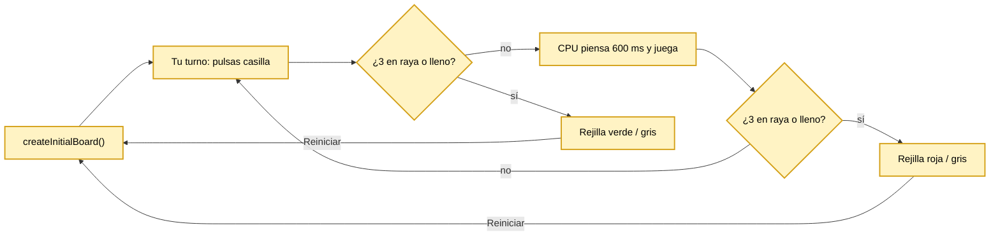
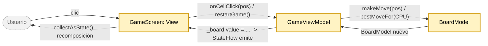
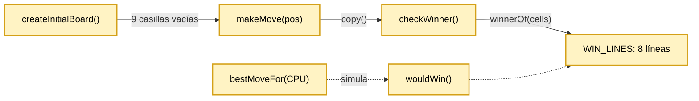
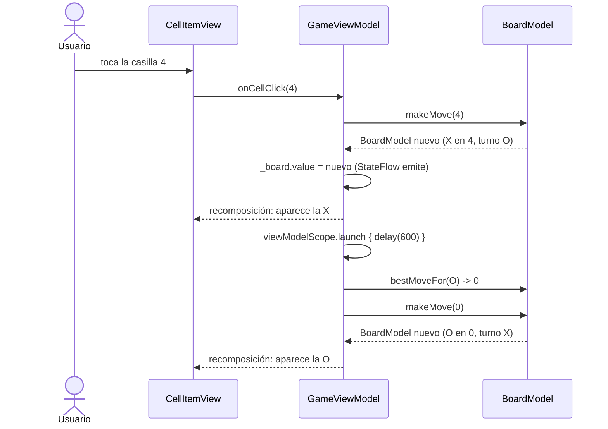
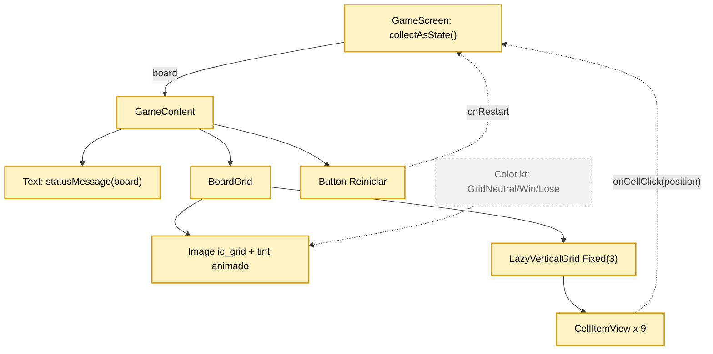
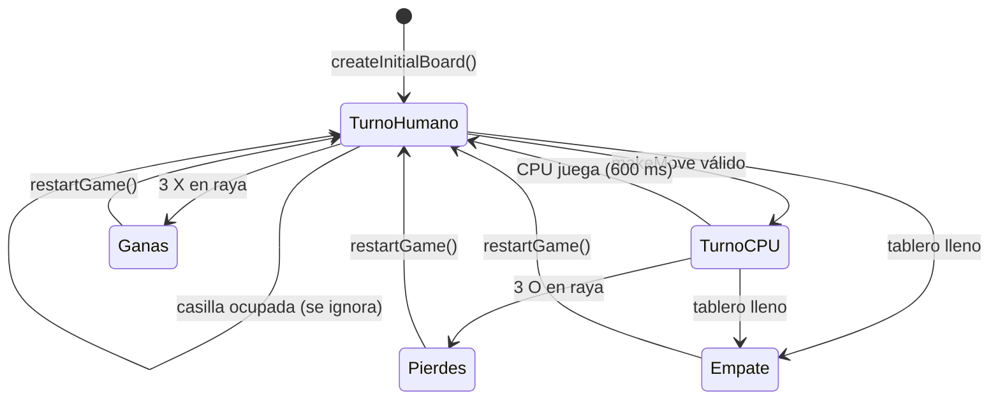
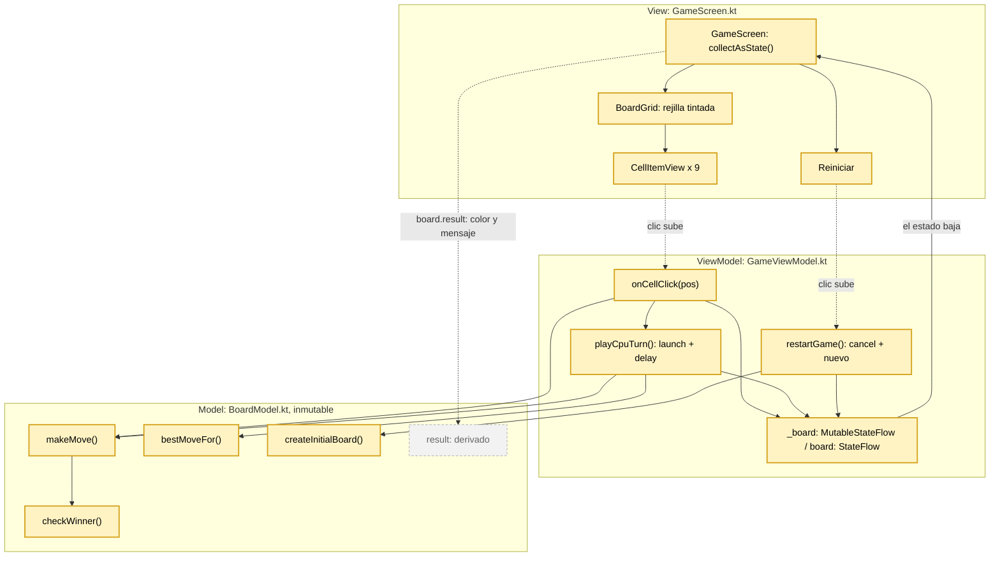

# Android-MVVM-TicTacToe: Tres en Ratlla (MVVM + Compose + StateFlow)

Proyecto **Tic Tac Toe** (`dam2.mmo.tictactoe`): un tres en raya contra la CPU, hecho en Android con Jetpack Compose y arquitectura **MVVM con el modelo separado** (filosofía de `MVVM-separatModel.kt`). Este documento explica qué hace cada archivo y cada método, y cómo viaja una jugada desde el dedo del usuario hasta la pantalla.

Práctica de **DAM 2** (INS Provençana).

## Tecnologías

- **Kotlin** + **Jetpack Compose** (Material 3)
- **MVVM** con `androidx.lifecycle` (`ViewModel`, `viewModelScope`, `viewModel()`)
- Estado reactivo con **`MutableStateFlow` / `StateFlow`** + `collectAsState()`
- Android `minSdk 24`, `targetSdk 37`

## Cómo ejecutarlo

1. Abre la carpeta `Proyecto` en **Android Studio** y espera al *Gradle Sync*.
2. Ejecuta la configuración `app` en un emulador o un móvil.

```shell
./gradlew :app:assembleDebug        # compila el APK
./gradlew :app:testDebugUnitTest    # tests del Model (sin emulador)
```

### Cómo leer los esquemas

- **Nodos amarillos:** clases, métodos o datos explicados en ese apartado.
- **Nodos grises discontinuos:** contexto de otros apartados.
- **Flecha continua:** se llama al método o los datos pasan al siguiente paso.
- **Flecha discontinua:** relación, consulta o consecuencia.

---

# 1. Anàlisi i documentació de l'arquitectura MVVM

> [!IMPORTANT]
> El enunciado pide responder **con tus propias palabras** a partir de `MVVMSimple.kt` y `MVVM-separatModel.kt`. Esta sección es la plantilla con las preguntas: rellénala tú. Las secciones 2 y 3 de este README te sirven de apoyo.

## 1.1. Documentación de los componentes (`MVVMSimple`)

- **Model:** ¿qué datos guarda y cuál es su función principal?
  - 
- **ViewModel:** ¿qué hace exactamente? ¿Cómo se comunica con el Model y cómo expone los datos a la interfaz?
 > - La clase viewModel guarda el estado del Modelo y luego expone estos datos para volver a repintar la pantalla, se comunica con el modelo creando un mutableState del mismo y declarandolo con una variable privada. Luego comunica estos datos como un estado del mutableState del modelo, de forma que estos datos son una variable publica solo de lectura y el valor mutable/modificable es una variable privada que solo se modifica desde el viewModel, en este caso la Clase `SimpleViewModel`.
 
- **View (UI / Compose):** ¿cuál es su papel? ¿Cómo recibe los cambios de estado y cómo avisa al ViewModel de las acciones del usuario?
 > - El view UI (`fun SimpleScreen`) Solo "pinta" la pantalla. Los cambios de estado los recibe de la val state, de allí saca values
 >```kotlin
 > //SimpleView
 >	private val _state = mutableStateOf(SimpleState())
 > 	val state: State<SimpleState> = _state
 >
 >	@Composable
 > fun SimpleScreen(
 >   viewModel: SimpleViewModel,
 >   modifier: Modifier = Modifier
 >	) {
 >   // Lectura directa del estado (.value) sin necesidad de 		 collectAsState()
 >  val state = viewModel.state.value
 >
 > ...}
 >	
 >Las acciones del usuario las obtiene de desde el argumento viewModel el cual es del tipo `SimpleViewModel`, con los eventos onClick del viewModel --> SimpleViewModel se modifican los valores de la clase y esta cambia su estado en _state la variable privada y se pasan a state la variable publica de la cual se obtienen los valores para repintar la pantalla con el @Composable
 >```
 > 

## 1.2. Análisis comparativo (`MVVMSimple` vs `MVVM-separatModel`)

**Estructura y separación de responsabilidades**
- ¿Qué diferencia hay entre la forma de organizar el Model en cada archivo? 
> La diferencia es que el MVVMSimple la logica del funcionament o fa el ViewModel, en canvi amb el MVVM-separatModel o fa el Model amb els seus metodes y la ViewModel nomes gira la carta, el resultat es treu de valor Derivats del estat actual del model. Com si la carta esta `match` o `fliped && !match`.

- ¿Dónde se ejecuta la lógica de negocio (comprobar combinaciones, girar cartas...) en cada uno?
> En el caso de `MVVMSimple` la logica esta en el ViewModel `SimpleView`y en el caso de `MVVM-separatModel` la logica esta en el mismo modelo`BoardModel`

**Inmutabilidad y gestión del estado**
- ¿Cómo se modifican los datos del tablero en `MVVM-separatModel`? ¿Qué papel juega `.copy()` y por qué es importante en una arquitectura reactiva?
> El estado se escribe en _board como mutable, se puede editar el valor, y en board, que no se puede editar el valor (Solo View), el `.copy` es importante porque al no poder editarse el valor de board, que es quien tiene el estado que consulta View, lo que se hace es copiar la variable modificando los valores que se quieran para luego igualar su valor a _board de esta forma el view nunca podrá modificar el valor directamente.
>```kotlin
> val board: StateFlow<BoardModel> = _board.asStateFlow()
>```
>Ha de pasar por el ViewModel --> GameViewModel para cambiar el estado.
>

**Ventajas de la separación**
- ¿Por qué es mejor desacoplar la lógica de negocio (`BoardModel`) del ViewModel a medida que la app crece? 
> Es mejor separar la logica porque asi el ViewModel queda limpio y con la unica funcion de `"actualizar el estado del modelo"` y no queda una logica de funcionamiento complicada y repartida en diferentes clases. Esto tambien ajuda a gestionar facilmente la app a medida que crece ya que todo es modular y no un funcionamiento descentralizado repartido en varias clases.
>

## 1.3. Análisis comparativo: `StateFlow` vs `mutableStateOf`

- `StateFlow` / `MutableStateFlow`: ¿para qué se usa? 
 > El StateFlow es el estado actual del modelo, Solo lectura, el mutableStateFlow es el estado interno, privado, que se va modificando desde el modelo con los eventos del ViewModel. Se usa para tener actualizado el estado actual del modelo desde el punto de vista de la misma ejecucion, ya que este usa coroutinas. Por esto hay que usar collectAsStateWithLifeCycle()
 
- `mutableStateOf` / `State<T>`: ¿para qué se usa? 
> Se usa igual que StateFlow y MutableStateFlow, la diferencia es que el compose lo detecta automaticamente al cambiar los valores. Se usa con Remember para que mantenga el valor entre ciclos de ejecucion.
- ¿Qué diferencias hay entre ellos? 
> El StateFlow usa Coroutinas y el State es propio de Jetpack Compose, StateFlow es Kotlin puro, State esta pensado para Compose 
- ¿Cuál escogerías para esta app y por qué? 
> Usaria StateFlow porque es mas general y no esta ligado a Compose.

> [!TIP]
> Pistas: compara JuegoParejas (`mutableStateOf`) con este proyecto (`StateFlow`). Fíjate en **qué importa cada ViewModel** (¿`androidx.compose` o `kotlinx.coroutines`?), en **cómo lee la View el estado** (`vm.model` directamente o `collectAsState()`) y en qué pasaría si la misma lógica se reutilizara fuera de Compose.

---

# 2. Arquitectura del Tres en Ratlla

## Las reglas

- Tablero **3x3**. Juegas con **X** (empiezas tú) contra la **CPU**, que juega con **O**.
- Gana quien haga **3 en raya** (fila, columna o diagonal). Si se llena el tablero sin ganador, es **empate**.
- La **rejilla del fondo** es blanca/gris translúcida. Cuando **ganas** se vuelve **verde** y cuando **pierdes**, **roja**. Mantiene la translucidez y el cambio de color está animado.



> _Captura / GIF de la app en funcionamiento: **TODO** (Android Studio → Running Devices → botón de grabar)._

## Quién hace qué

| Capa | Archivo | Responsabilidad | ❌ No debe... |
|---|---|---|---|
| **Model** | `BoardModel.kt` | `Symbol`, `CellModel`, `BoardModel`: casillas, jugadas, ganador, IA | Importar nada de Android ni Compose |
| **ViewModel** | `GameViewModel.kt` | `StateFlow` del tablero, eventos, turno de la CPU | Conocer `@Composable` ni reglas del juego |
| **View** | `GameScreen.kt` | `GameScreen`, `GameContent`, `BoardGrid`, `CellItemView` | Decidir quién gana o si una casilla está libre |
| **Entrada** | `MainActivity.kt` | `setContent { GameScreen() }` | Tener estado o lógica |

```text
Proyecto/
├── svg/                         <- fuentes de diseño: cross.svg, circle.svg, grid.svg
└── app/src/
    ├── main/java/dam2/mmo/tictactoe/
    │   ├── MainActivity.kt      <- entrada
    │   ├── GameScreen.kt        <- View
    │   ├── GameViewModel.kt     <- ViewModel
    │   ├── BoardModel.kt        <- Model
    │   └── ui/theme/Color.kt    <- GridNeutral, GridWin, GridLose
    ├── main/res/drawable/       <- ic_cross.xml, ic_circle.xml, ic_grid.xml
    └── test/.../BoardModelTest.kt
```



## Model: `BoardModel.kt`

Kotlin puro e **inmutable**: cada método devuelve un `BoardModel` nuevo con `.copy()`.

| Pieza | Qué es |
|---|---|
| `enum Symbol { X, O, EMPTY }` | Contenido de una casilla. Un enum evita errores como `"x"` o `"0"` de un String |
| `enum GameResult` | `PLAYING`, `HUMAN_WINS`, `CPU_WINS`, `DRAW`: el resultado visto por el humano |
| `CellModel(id, position, symbol)` | Una casilla. `isEmpty` es derivada |
| `BoardModel(cells, currentTurn, winner, isDraw)` | La partida. `isGameOver`, `isHumanTurn` y `result` son **derivadas** |

### `makeMove(position)`

```kotlin
fun makeMove(position: Int): BoardModel {
    if (isGameOver) return this                   // 1. partida acabada
    if (position !in cells.indices) return this   // 2. fuera de rango
    if (!cells[position].isEmpty) return this     // 3. casilla ocupada
    val newCells = cells.map { cell ->            // 4. lista NUEVA
        if (cell.position == position) cell.copy(symbol = currentTurn) else cell
    }
    return copy(cells = newCells, currentTurn = currentTurn.opponent())
        .checkWinner()                            // 5. se encadena la comprobación
}
```

### `checkWinner()`

Recorre las 8 líneas de `WIN_LINES`. El **ganador se comprueba antes que el empate**: si la última ficha llena el tablero y además hace 3 en raya, es victoria.

```text
 0 | 1 | 2      filas:      012 345 678
 3 | 4 | 5      columnas:   036 147 258
 6 | 7 | 8      diagonales: 048 246
```

### `bestMoveFor(symbol)`: la IA

Por orden de prioridad: **ganar → bloquear → centro → esquina al azar → cualquiera**. `wouldWin()` simula la jugada sobre una lista copiada sin tocar el tablero real. No prevé las dobles amenazas, así que **se le puede ganar**.



## ViewModel: `GameViewModel.kt`

```kotlin
private val _board = MutableStateFlow(BoardModel.createInitialBoard())  // privado y mutable
val board: StateFlow<BoardModel> = _board.asStateFlow()                 // público y de solo lectura

fun onCellClick(position: Int) {
    val current = _board.value
    if (!current.isHumanTurn) return               // durante el turno de la CPU, se ignora
    val afterHuman = current.makeMove(position)
    if (afterHuman === current) return              // jugada inválida: mismo objeto
    _board.value = afterHuman                       // StateFlow emite
    if (!afterHuman.isGameOver) playCpuTurn()
}
```

- **`playCpuTurn()`**: `viewModelScope.launch { delay(600); ... }`. La corrutina se guarda en `cpuJob`.
- **`restartGame()`**: `cpuJob?.cancel()` y después tablero nuevo. Sin el `cancel`, si reinicias mientras la CPU "piensa", jugaría en el tablero recién creado.



## View: `GameScreen.kt`

| Composable | Tipo | Qué hace |
|---|---|---|
| `GameScreen` | Con estado | `vm.board.collectAsState()` y conecta lambdas |
| `GameContent` | Sin estado | Fondo, título, mensaje de estado, tablero y botón Reiniciar |
| `BoardGrid` | Sin estado | `Box` con la rejilla tintada debajo y `LazyVerticalGrid` 3x3 encima |
| `CellItemView` | Sin estado | Casilla cuadrada pulsable con `ic_cross`, `ic_circle` o nada |

### La rejilla que cambia de color

1. `ic_grid.xml` se dibuja en **blanco opaco**.
2. `Color.kt` define tres colores con el **mismo alfa** (`GRID_ALPHA = 0.45f`): `GridNeutral` (gris), `GridWin` (verde) y `GridLose` (rojo).
3. `BoardGrid` elige el color según `board.result` y lo pasa por `animateColorAsState` (600 ms).
4. `ColorFilter.tint(gridColor)` sustituye el blanco del dibujo por ese color, **incluido el alfa**, así que se mantiene la translucidez.

### SVG y Vector Drawable

Android **no carga `.svg`** en `res/drawable`. Su formato vectorial es el XML `<vector>`. En `svg/` están los SVG originales y en `res/drawable/` su traducción 1:1 (`viewBox` → `viewportWidth/Height`, `d` → `pathData`). Android Studio lo hace solo con **File → New → Vector Asset → Local file**. El `<circle>` de SVG se convierte en dos arcos `A`, porque `<vector>` no tiene círculos.



## Estados de la partida



---

# 3. Conceptos y métodos aprendidos

| Concepto | Dónde | Para qué |
|---|---|---|
| `MutableStateFlow(valor)` | ViewModel | Estado observable que siempre tiene un valor (`.value`) |
| `asStateFlow()` | ViewModel | Exponer el estado como solo lectura |
| `collectAsState()` | View | Convertir un `StateFlow` en `State` de Compose para recomponer |
| `viewModelScope.launch { }` | ViewModel | Corrutina que muere con el ViewModel |
| `delay(ms)` | ViewModel | Esperar sin congelar la interfaz |
| `Job.cancel()` | ViewModel | Cancelar el turno pendiente de la CPU al reiniciar |
| `===` | ViewModel | Comparar referencias: ¿`makeMove` devolvió `this`? |
| `.copy()` | Model | Crear una versión modificada de un `data class` inmutable |
| `enum class` + `when` exhaustivo | Model / View | Valores cerrados; el compilador obliga a tratar todos |
| `List(n) { i -> }` | Model | Crear las 9 casillas con su índice |
| `firstNotNullOfOrNull { }` | Model | Primera línea ganadora, o `null` |
| `?.let { return it }` | Model | Salir de la función si se encontró algo |
| `LazyVerticalGrid` + `GridCells.Fixed(3)` | View | Rejilla de 3 columnas sin calcular índices |
| `items(lista, key = { it.id })` | View | Identidad estable de cada casilla |
| `Modifier.aspectRatio(1f)` | View | Casillas cuadradas |
| `animateColorAsState` + `tween` | View | Transición suave gris → verde/rojo |
| `ColorFilter.tint(color)` | View | Recolorear un drawable conservando la transparencia |
| `Color.copy(alpha = …)` | Color.kt | Mismo color con otra opacidad |
| `<vector>` / Vector Asset | `res/drawable` | El equivalente Android de un SVG |
| `fold` | Previews / tests | Aplicar una lista de jugadas al tablero |

---

# Cheatsheet

| Método | Capa | Devuelve | Qué hace |
|---|---|---|---|
| `BoardModel.createInitialBoard()` | Model | `BoardModel` | 9 casillas vacías, empieza X |
| `makeMove(position)` | Model | `BoardModel` | Coloca, pasa turno y `checkWinner()`; inválida → `this` |
| `checkWinner()` | Model | `BoardModel` | Rellena `winner` o `isDraw` |
| `bestMoveFor(symbol)` | Model | `Int?` | Ganar → bloquear → centro → esquina → cualquiera |
| `onCellClick(position)` | ViewModel | `Unit` | Jugada humana y lanza la CPU |
| `restartGame()` | ViewModel | `Unit` | Cancela la CPU y crea un tablero nuevo |

# Esquema completo del flujo



## La regla de oro

> **El Model decide, el ViewModel delega y organiza los turnos, la View pinta y avisa. Cada jugada es `_board.value = _board.value.makeMove(...)`.**

## Recuerda

1. **Modelo inmutable:** `makeMove` devuelve un `BoardModel` nuevo; nunca se cambia `cells` a mano.
2. **`_board` privado, `board` público** con `asStateFlow()`: un único dueño del estado.
3. **`collectAsState()` en la View** para que Compose se entere de cada emisión.
4. **Jugada inválida = `this`:** el ViewModel lo detecta con `===` y no lanza la CPU.
5. **Bloquea los clics en el turno de la CPU** (`isHumanTurn`): si no, el humano pondría la O.
6. **Cancela la corrutina al reiniciar:** `cpuJob?.cancel()`.
7. **Ganador antes que empate** en `checkWinner()`.
8. **Datos derivados:** `isGameOver`, `isHumanTurn` y `result` se calculan; no se guardan.
9. **Android no lee SVG:** conviértelo a `<vector>` con Vector Asset.
10. **Translucidez con un solo drawable:** blanco opaco + `ColorFilter.tint()` con colores del mismo alfa.
